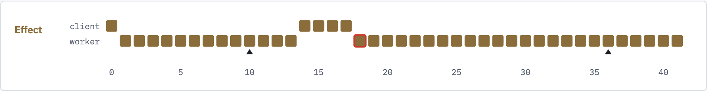
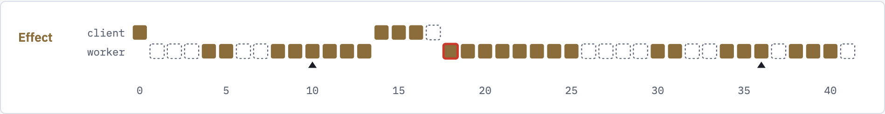
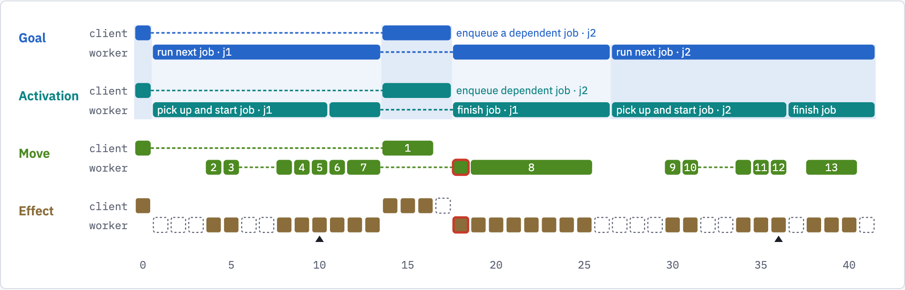
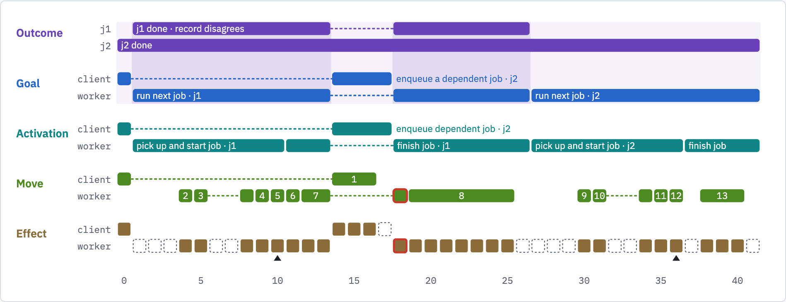

# Code Draws Every Boundary of the Ladder, and the LLM Only Names the Steps

A step-by-step walkthrough of how one recorded run becomes a stack of levels, using the real rq run where rq's bug happens. It illustrates sections 5 and 8 of the [report](report.md). Every number and name comes from the experiment: the run is the `witness` in [`experiments/results/levels.json`](experiments/results/levels.json), and the step names are the majority names from six LLM samples in [`experiments/results/llm.json`](experiments/results/llm.json). Where the closing rules and the report's hand grouping differ (13 moves against 11), this page follows the rules.

**The idea in three sentences.** Code cuts the run into steps from the bottom up, with one *closing rule* per level that says where one step of that level ends. Going up a level is always the same move: group the steps below by the next rule, and record which lower steps went into which upper step (the *step map*). Next to it, the *state map* says what the upper level can see; for rq that is each job's status, which lists it appears in, and its result.

## The whole path


Only one step uses an LLM, and it comes after every boundary is fixed. Steps 2 to 6 build the levels of one run, step 7 turns many runs into the model, and step 8 decides which levels stay.

| Level | One step is | It closes when | Example run | Mean per run (2,097 runs) |
|---|---|---|---|---|
| Outcome | one job's whole life | grouped per job: every goal that changes what a user can see about that job | 2 | 1.2 |
| Goal | one actor gets one thing done | the actor's call returns its answer | 3 | 2.2 |
| Activation | one actor's uninterrupted turn | the actor has to wait: the call returns, or it hands control to the job's own code | 5 | 3.3 |
| Move | one move of a mechanism: a claim, an attempt, a commit | after each write on the causal chain, or a rejected transaction | 13 | 7.3 |
| Effect | one Redis command, transaction or script | the interpreter runs it as one step | 42 (28 on the chain) | 25.7 (14.7) |

## The example: two jobs, one worker

rq is a Python job queue on top of Redis. In this run job `j1` is already waiting in the queue. A **client** submits job `j2` with the instruction "run after `j1`". A **worker** runs `j1`, which should release `j2`, and then runs `j2`.

The client and the worker take turns at the store in an order the explorer chose. In this order the client registers `j2` in the middle of the worker finishing `j1`. The worker's commit is rejected, its retry commits less than it should, and `j1` ends up **finished but still listed as started**. That is the real rq bug from the [abstraction-function report](../abstraction-function/report.md).


At the bottom there are only two processes and one store. Everything above this, such as "job", "attempt" or "goal", has to be built out of the 42 commands they send.

## Step 1. Record the run: effects

- **One step is** one Redis command, transaction or script: whatever the scheduler lets one actor do before another may go.
- **Who does it:** the interpreter. In the experiment, that was real rq code under a scheduler that interleaves actors at each Redis call.
- **Result:** 42 effects, 5 by the client and 37 by the worker.



Time runs left to right. The client's five steps arrive at 0 and 14–17, in the middle of the worker's. The red outline at 18 is the transaction Redis rejected. A triangle marks where the job's own code ran.

**What this level shows.** The participants are processes and Redis keys. Here are effects 12 to 25:


The cause is in this picture, but you have to find it. It is three commands, `DEL rq:execution…`, `ZREM rq:wip…` and `ZREM rq:executions…`, that are in attempt 1 (effect 18) and missing from attempt 2 (effect 25). To see that, you compare two transactions of 14 and 17 commands.

## Step 2. Mark the causal chain, fold the bookkeeping

- **A step is on the chain when** it changes what a user can see about a job, or it writes a key that a later step on the chain reads, or it is a read by an actor that later, in the same call, does something on the chain. Every other step is a **support step**.
- **Who does it:** code, walking the run backwards over what each step read and wrote. No judgment is involved.
- **Result:** 28 steps on the chain and 14 support steps. Twelve are the worker updating its own state and heartbeat. One registers the queue name, which nothing reads, and one is a heartbeat on `j2`.



Hollow blocks are support steps. They stay in the model and show as a count, such as "5 bookkeeping steps". They are never deleted and never hide an error. Over all runs, 43% of effects are support.

## Step 3. Group effects into moves

- **Closes when** an on-chain effect writes something, or a transaction is rejected. Reads join the move they feed, so "watch, read, then commit" is one move.
- **Identified by** the API call, the rq function that closes it, and which key families it writes, for example `work · Queue.lmove · rq:queue:*`.
- **Result:** 28 on-chain effects become 13 moves.


This is the move from one level to the next. The shaded columns show which effects fall into each new move. A move can have a gap: the client's move 1 is effect 0 plus effects 14–16, because the worker ran in between. Steps are grouped by who did them and what they belong to, never by position in time.

The numbers in the figure are the moves in order of their first effect:

| Move | Actor | Name (LLM) | Effects | Class |
|---|---|---|---|---|
| 1 | client | commit job as deferred | 0, 14–16 | `m:509a00` |
| 2 | worker | take job from queue | 4 | `m:34e4a3` |
| 3 | worker | register job execution | 5, 8 | `m:85ae07` |
| 4 | worker | mark job started | 9 | `m:b7706e` |
| 5 | worker | keep job while running | 10 | `m:8e69df` |
| 6 | worker | record worker heartbeat (wrong: it is the job's heartbeat) | 11 | `m:02365a` |
| 7 | worker | attempt success commit, rejected | 12, 13, 18 | `m:30455a` |
| 8 | worker | finish job and release dependents | 19–25 | `m:0fccaa` |
| 9 | worker | take job from queue | 30 | `m:34e4a3` |
| 10 | worker | register job execution | 31, 34 | `m:85ae07` |
| 11 | worker | mark job started | 35 | `m:b7706e` |
| 12 | worker | keep job while running | 36 | `m:8e69df` |
| 13 | worker | commit job success | 38–40 | `m:4ecdcc` |

**What this level shows.** The participants are actors and the mechanism they use, with no single commands:


At the move level, the cause can be stated in one sentence: "the retry committed less than the first attempt prepared".

## Step 4. Group moves into activations

- **Closes when** the actor has to wait: its call returns, or it hands control to code outside the library. For a worker that is the job's own function, which rq calls in the middle of `work()`.
- **Identified by** the API call and which part of it ran: `work, part 0` is before the job's code, `work, part 1` after it.
- **Result:** 13 moves become 5 activations.


The worker's run of `j1` splits in two at the triangle, where the job's code ran. All six free-form ladders the LLM proposed in design C had a "job lifecycle" level that matches this one.

**What this level shows.** The participants are actors, their turns, and the gaps where they wait:


At the activation level you see the overlap. The client's turn ran across the worker's two turns on `j1`, and its write landed in the middle of "finish job".

## Step 5. Group activations into goals

- **Closes when** the actor's call returns its answer: `enqueue` returns the job id, `work` returns "worked".
- **Identified by** the API call, plus what it changed in what a user can see.
- **Result:** 5 activations become 3 goals.



Each goal is one actor's call from start to answer. The client's goal and the worker's first goal overlap in time. That does not matter at this level, because each goal is read by what it achieved.

**What this level shows.** The participants are actors and the subjects they act on. Each cell below is the state map at work: what a user can see about the job, before and after the goal.


At the goal level you see the symptom: the worker's first goal finished `j1`, yet `j1` is still listed as started.

## Step 6. Group goals into outcomes

- **Groups** per subject, here a job, every goal that changes what a user can see about it. Subjects are chosen once per project; for rq the subject is the job.
- **Result:** 3 goals become 2 outcomes. The goal "run next job" for `j1` belongs to both, because finishing `j1` also released `j2`. Over all runs 4.4% of goals belong to two outcomes, so the top of the ladder is not a strict tree.



This is the full ladder on one run. Following any block down to the blocks it contains, and up to the blocks that contain it, is reading the step map.

**What this level shows.** A manager reads two lines:


The marker on `j1` is all a manager needs to know that something below is wrong. The status chains on the right are the detail of each line.

## Step 7. From one run to the model: step classes

Steps 1 to 6 cut *one* run. The model has to show *any* run, so each step is generalised to a **step class**: the kind of step it is, identified by names from the code. Both of the worker's goals in the example belong to the class `g:work`. The four moves of "pick up and start job" happen in every run that takes a job.

A step class can unfold in more than one way. "Finish job" sometimes commits at once, and sometimes is rejected and then retried. These alternatives are the step's **cases**. The step map stored in the model is this tree of classes and their cases. Here is part of it for rq 2.12, with the classes seen in the example run marked:

```text
g:enqueue-dependent   enqueue a dependent job                     (in this run)
└ a:enqueue-dependent:0   enqueue dependent job                   (in this run)
    case  m:509a00  commit job as deferred                        (in this run)
    or    m:183844  queue dependent job
    or    m:840bf6  attempt deferral, rejected

g:work   run next job                                             (in this run, twice)
├ a:work:0   pick up and start job                                (in this run)
│   1. m:34e4a3  take job from queue
│   2. m:85ae07  register job execution
│   3. m:b7706e  mark job started
│   4. m:8e69df  keep job while running
└ a:work:1   finish job                                           (in this run)
    case  m:4ecdcc  commit job success                            (in this run, for j2)
    or    m:ca9dee  commit success, enqueue dependents
    or    m:30455a  attempt success commit, rejected, then retry  (in this run, for j1)
    or    m:6ed7ed  commit job failure
    or    m:1ecc1d  commit failure, requeue for retry
```

| Level | Steps in this run | Classes in this run | Classes, all runs | Same in rq 3.0 | Same in rq 2.0 |
|---|---|---|---|---|---|
| Goal | 3 | 2 | 7 | 100% | 100% |
| Activation | 5 | 3 | 8 | 100% | 100% |
| Move | 13 | 9 | 29 | 86% by call and function, 50% with keys | 52% by call and function, 46% with keys |

Move classes that include the keys they write carry over less well, because rq 3.0 renamed its Redis keys.

## Step 8. Decide which levels stay

The architecture offers seven kinds of level. A project keeps a level only when it passes the admission tests, and the results are stored in the level's charter, so anyone can see why the level exists. On rq two kinds merged into a neighbour, because their steps were the neighbour's steps again.


The test that decided this: merge two levels when about four in five upper steps contain exactly one lower step. The test first proposed, that each upper step should hold two to seven lower ones, failed on rq: going up, real steps hold 1.5 to 2.2. So a small grain alone is not a reason to drop a level. A system with several services, or work that passes between people, would keep exchange or stage; the same tests decide.

| Test | A level passes when |
|---|---|
| A1 | its charter names a reader and the question they ask |
| A2 | it adds or hides words compared with its neighbours |
| A3 | it does not restate a neighbour (the merge test above) |
| A4 | something can be said at this level and not above it; for the move level that is the cause of the rq bug |
| A5 | a run read at this level makes sense in its own words |
| A6 | every step class has a parent that says what it is for |

## Step 9. What the LLM adds: names and charters

Only now, with every boundary fixed and every class known, does the LLM see the model. It gets one step class at a time, with its children's names and the change it makes, and it answers with a name. It also writes each level's charter: who reads the level and what question it answers.

The question, for one goal class:

```text
Level: goal (one actor gets one thing done)
Actor: worker      Subject: job
Before: queued, in the queue
After:  finished, listed as finished, result 1
Made of: "pick up and start job", "finish job"
Use only this level's words. Verb first, at most four words.
```

The majority answer: `run next job`.

Code checks every answer: no storage words, and no two classes with different results get the same name. Six samples never broke either check. But they gave the identical name only 21–37% of the time, so **names are generated once and stored**. One majority name was wrong: "record worker heartbeat" for what is the job's heartbeat (move 6 above). A person corrects it once, and the correction stays.

| Level | Reader | Question it answers | Answered from (stand-in reader) |
|---|---|---|---|
| Outcome | manager | Did each piece of work get done? | 2–3 lines |
| Goal | product, support, QA | What did each party get done, and did it work? | 3–4 lines |
| Activation | developer | What did each actor do in each turn, and where did turns overlap? | not tested |
| Move | developer on a concurrency problem | Which claims, attempts and commits happened, in what order? | 9–15 lines |
| Effect | developer, coding agent | Which exact command did it? | all 42 |

The questions are written for this page to show the form; in the pipeline the LLM writes them and a person can edit them. The last column is from the reader test, which used an LLM as the reader, not people.

## Step 10. Read a run: choose a cut

A view never switches the whole run to one level. It shows a **cut**, a set of steps that covers the run once. Some parts stay closed high up and others are opened down to where the trouble is. The same run, for four readers:

**Manager: 2 steps.**

```text
OUTCOME  j1 done, its record disagrees                              ⚠
OUTCOME  j2 done
```

**Product owner: 3 steps.**

```text
GOAL  client  enqueue a dependent job · j2        5 effects
GOAL  worker  run next job · j1                  22 effects   ⚠ j1 finished, still listed as started
GOAL  worker  run next job · j2                  15 effects
```

**The cut that explains the bug: 6 steps under 2 open headers.**

```text
GOAL  client  enqueue a dependent job · j2        5 effects
GOAL  worker  run next job · j1                                ⚠ j1 finished, still listed as started
├ ACTIVATION  pick up and start job · j1         10 effects, 5 support folded
└ ACTIVATION  finish job · j1                                  ⚠ ran across the client's enqueue
  ├ MOVE 6  record worker heartbeat              effect 11
  ├ MOVE 7  attempt success commit, rejected     12, 13, 18    ⚠ the client wrote j1's dependents
  └ MOVE 8  finish job and release dependents    19–25         ⚠ commits less than attempt 1 prepared
GOAL  worker  run next job · j2                  15 effects
```

Opening move 8 one more level shows effect 25 as the evidence: the commit without `DEL rq:execution…`, `ZREM rq:wip…` and `ZREM rq:executions…`.

**Developer: all 13 moves.**

```text
GOAL  client  enqueue a dependent job · j2
└ ACTIVATION  enqueue dependent job · j2              1 support folded
  └ MOVE 1   commit job as deferred                   0, 14–16
GOAL  worker  run next job · j1
├ ACTIVATION  pick up and start job · j1              5 support folded
│ ├ MOVE 2   take job from queue                      4
│ ├ MOVE 3   register job execution                   5, 8
│ ├ MOVE 4   mark job started                         9
│ └ MOVE 5   keep job while running                   10
└ ACTIVATION  finish job · j1                         1 support folded
  ├ MOVE 6   record worker heartbeat                  11
  ├ MOVE 7   attempt success commit, rejected         12, 13, 18   ⚠
  └ MOVE 8   finish job and release dependents        19–25        ⚠
GOAL  worker  run next job · j2
├ ACTIVATION  pick up and start job · j2              5 support folded
│ ├ MOVE 9   take job from queue                      30
│ ├ MOVE 10  register job execution                   31, 34
│ ├ MOVE 11  mark job started                         35
│ └ MOVE 12  keep job while running                   36
└ ACTIVATION  finish job · j2                         2 support folded
  └ MOVE 13  commit job success                       38–40
```

Over all 554 anomalous runs, the cut that opens only the steps that differ from every clean run had at most 6 steps. In the experiment the cut was computed this way, by comparison with clean runs. Choosing it by degree of interest around a focus (report, section 5.7) is the proposal and is not built yet.

## Limits

- One library, one run shown. The rules were measured on all 2,097 explored rq runs; the pictures show one of them.
- The closing rule for moves closes at every write. The report's hand grouping read intent instead and found 11 moves, for example treating moves 4 and 5 as one "mark started". Whether a move should close at every write or at the end of an atomic group is left open.
- The charter questions on this page are illustrations, and the reader numbers come from an LLM reader, not from people.

The figures were rendered from an interactive version of this page, with the same data.
