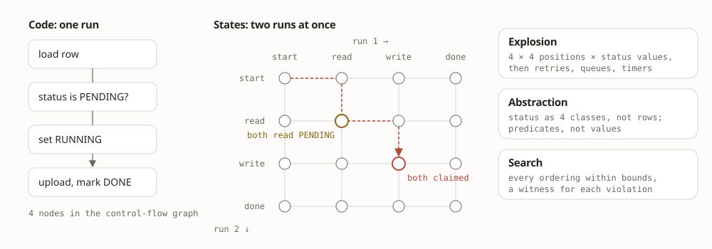

# Mental: specification

**Status:** design, nothing is built yet. **Date:** 2026-11-18.

Every term in **bold** on first use is defined in the [glossary](glossary.md). Facts from trials and research are in [findings](findings.md) and cited as F-numbers.

Each section carries a status:

- **Decided:** confirmed by the owner.
- **Proposed:** the working answer, not yet confirmed.
- **Experiment:** under test; the experiment that settles it is named.
- **Later:** not part of version one.

Nothing here is final. A measured result overrules any sentence in this document.

## Contents

1. [What Mental is](#1-what-mental-is)
2. [Principles](#2-principles)
3. [Three tools](#3-three-tools)
4. [The build at a glance](#4-the-build-at-a-glance)
5. [Stage 1: the build model](#5-stage-1-the-build-model)
6. [Stage 2: from code to facts](#6-stage-2-from-code-to-facts)
7. [The model](#7-the-model)
8. [Stage 3: the mechanical model](#8-stage-3-the-mechanical-model)
9. [Stage 4: what the LLM adds](#9-stage-4-what-the-llm-adds)
10. [Stage 5: link, load, close](#10-stage-5-link-load-close)
11. [Stage 6: levels](#11-stage-6-levels)
12. [`mentalvm`: running the model](#12-mentalvm-running-the-model)
13. [`mentaldbg` and the viewer](#13-mentaldbg-and-the-viewer)
14. [Version one: scope and milestones](#14-version-one-scope-and-milestones)
15. [Later, experiments and open questions](#15-later-experiments-and-open-questions)

---

## 1. What Mental is

**The problem.** To change a system safely, a person needs a picture of it in their head: what the parts are, how a request moves through them, what can go wrong when two things happen at once. Today that picture is rebuilt by reading code, and a coding agent rebuilds its own in every session. Neither picture can be run, checked or shared.

**The answer.** Mental compiles a repository into a **model**: a description of the system that a program can run. On the model you can:

1. **Run a scenario** and get a **trace** of what happens, step by step.
2. **Zoom** into any step to see what it is made of, or out to see what it belongs to.
3. **Search** all orderings of concurrent steps within stated bounds and get a replayable **witness** for each race or dead end.
4. **Change something** (a bound, an assumption) and see what changes.
5. **Share the view** with a coding agent: what you have selected is the agent's context.

**What the model describes.** The model is a simulation of the running system: processes on machines, exchanging messages and changing stored state. Source code is not the thing modelled. It is the main evidence: source, build files and lockfiles are observations of the real system, and the model is **grounded** as far as its records are anchored to them. A place where evidence is missing is a gap ([6.4](#64-gaps-and-the-gate)), and the model says so there. Below the code the model stops at stated assumptions about the interpreter, the libraries and the operating system ([11.6](#116-below-the-code)).

**What Mental is not.** It does not execute your code. It does not prove that code has no bugs: a result holds within the model and within stated bounds, and says so. It is not a diagram generator: every item in the picture is a record the interpreter uses.

**The running example.** [`examples/report-jobs`](../examples/report-jobs/) is the first target. An API (`POST /reports`) stores a `PENDING` row in Postgres and queues a Celery task through Redis. Workers take tasks, build a CSV, upload it to S3 and mark the row `DONE`. It is about 190 lines and contains four real bugs (F-S11), including a race in which the same report is processed twice.

## 2. Principles

**Status: Decided**, except where a principle is marked.

| # | Principle | In short |
|---|---|---|
| **P1** | A system is a transition system | A **state** is a snapshot, a **transition** is one thing happening, a **run** is a path. Safety asks whether some path reaches a bad state; liveness asks whether every path reaches a good one. |
| **P2** | The state graph is generated on demand | The model stores an initial state and a step function, never the states. |
| **P3** | The model abstracts values into conditions and classes | A **predicate** stands for a test in the code, an **input class** for all inputs that behave alike, a **case** for all paths that end alike. |
| **P4** | Many small machines that talk through ports | One **behavior** per **provided port**, one **lifecycle machine** per **state variable**, **packs** for libraries. A **race** is two steps that touch the same state, at least one writing, whose order matters. |
| **P5** | The model is a program | `mentalc` compiles it, `mentalvm` runs it, `mentaldbg` debugs it. A record the interpreter ignores does not belong in the model. |
| **P6** | Mechanical facts first; the LLM adds readability, never facts | Extractors own structure and completeness. The LLM names things and summarizes. It never removes a branch, decides what is feasible, places a step boundary or writes a trace (F-R1 to F-R3, F-S12, F-A5). *Proposed in this sharper form.* |
| **P7** | Every claim is anchored and says how it is known | Each record has an **anchor** (file, lines, quote), a provenance, a source and the checks it passed. |
| **P8** | Identity comes from the code | IDs are built from code names, never from positions or from the LLM. Rebuilds keep IDs stable. |
| **P9** | Fail rather than degrade | A missing input stops the build with the fix named. Nothing is guessed, and no weaker result is written in place of a full one. |
| **P10** | `mentalc` runs nothing the repository controls | No build tool, package manager, interpreter or script from the repository, and no network. When a command is needed, `mentalc` names it and the user or their agent runs it (F-U12, F-U14, F-U17). |
| **P11** | The model and the picture are separate | Model (facts), run (one execution), view state (what is shown), skin (how it looks). Information flows only downward. |
| **P12** | What you look at is the agent's context | The viewer and the coding agent share one **session**. |



## 3. Three tools

**Status: Decided.**

| Tool | One job | Reads | Writes | Never |
|---|---|---|---|---|
| **`mentalc`** | compile | a repository, packs, answers from an LLM backend | the model, diagnostics, the call ledger | runs the model |
| **`mentalvm`** | interpret | a model, a binding, a schedule, edits | runs, findings, witnesses | reads source code |
| **`mentaldbg`** | debug and show | a model and runs | saved runs and view state | changes the model |

- The tools talk through files in a specified format ([7.5](#75-storage)), so each can be built and tested alone.
- All three are written in Rust in one workspace. `mentalc` and `mentalvm` never depend on each other.
- **Checks that need a run belong to `mentalvm`.** `mentalc` runs only static checks. `mentalvm check` runs the ones that need the interpreter and adds its diagnostics to the same file.
- The LLM is a setting of the compiler: by default the user's own coding agent answers `mentalc`'s tasks ([9.3](#93-llm-backends)).

## 4. The build at a glance

**Status: Proposed.** `mentalc build` runs six stages in order. Stages 1 to 3 and 5 use no LLM.

| Stage | Question | Produces | LLM | Milestone |
|---|---|---|---|---|
| 1. **Build model** | What parts does the project have, and how does each become something that runs? | build units, pins | no | 1 |
| 2. **Facts** | What does the code refer to, and what does it do? | reference sites with outcomes; the call graph; obligations; effects; state variables; entry points | no | 1, 2 |
| — **The gate** | Is anything missing that could change the model? | a failed build with fixes, or a go | no | 1, 2 |
| 3. **Mechanical model** | What is the system, stated only from facts? | entities, ports, full behaviors, predicates, machines, moves with verdicts; the first findings | no | 3 |
| 4. **LLM** | What should things be called, and how do the paths group? | names, input classes, summary cases, terms | yes | 4 |
| 5. **Link, load, close** | What is connected to what, and what runs? | wires, actors, drivers, stubs | no | 5 |
| 6. **Levels** | What does a reader at each level see? | step classes, the step map, charters | names only | 6 |

Three properties of this order:

- **Each stage ends with something checkable on report-jobs**, and the first findings arrive at stage 3, before any LLM call and before the interpreter exists. Three of the four report-jobs bugs follow from mechanical facts alone (F-S12).
- **The gate sits before the first paid call.** A build that will fail does not spend LLM answers.
- **An LLM answer can change how the model reads, never what it allows.** The interpreter runs the mechanical records; summaries are checked against them.

### 4.1 Commands and exit codes

**Status: Decided.**

| Command | Does |
|---|---|
| `mentalc init` | writes `mentalc.toml` and adds `.mental/` to `.gitignore` |
| `mentalc build` | runs the stages; stops at the first stage that fails |
| `mentalc check` | re-runs the static checks on an existing model without calling an LLM |
| `mentalc task next`, `mentalc task submit` | the task protocol of the `agent` backend ([9.3](#93-llm-backends)); also offered as MCP tools by `mentalc mcp` |
| `mentalvm run`, `explore`, `replay`, `check` | one run; a bounded search; a stored schedule replayed; the checks that need the interpreter |

Every command has a `--json` form. `--offline` forbids every LLM call: answers come from the cache only, and a miss is an error. Human-written input is TOML, tool output is JSON or JSONL.

| Exit code | Means |
|---|---|
| 0 | success |
| 1 | the command ran and found error-level problems: gaps, failed checks, a violation found by search |
| 2 | the tool itself failed: I/O, configuration, the LLM backend, a cache miss when offline, bad usage |

## 5. Stage 1: the build model

**Status: Decided (2026-11-18).**

Before it reads a line of code, `mentalc` builds a small model of how the project is built: the **build model**, the way Maven's `pom.xml` describes a Maven project. Type checkers do not do this for Python: they guess the roots and use one environment per config, and take a real project model only where a build system exports one ([type checkers and builds](research/type-checkers-and-builds/report.md)). The build model is that export.

A project is what Python already calls one: a directory with a `pyproject.toml`, as `uv init` makes it, with a `uv.lock`, a `.python-version` file and, after `uv sync`, a `.venv`. Mental needs no file of its own to read a project.

### 5.1 Records

| Record | Says | Fields |
|---|---|---|
| **build unit** | one project. It has source roots, a Python version, a lockfile and the environment its references resolve against | `id`; `dir`; `roots`; `python`: version and its source; `requires_python`; `lock`: path and schema version; `environment`: path |
| **pin** | one package of a build unit at an exact version, from its lockfile | `id`; `package` (normalized name); `version`; `origin`: registry, a git commit, or a path |

"Component" stays the word for a box inside a service; a part built on its own is a **build unit**. The system and its build unit take the project's name.

*In report-jobs:* one build unit, named `reports` after the project, with a pin for each package in `uv.lock` other than the project itself.

### 5.2 Readers

Small readers, one per file. There is no model of the build tool itself, and `mentalc` starts no process.

| Input | Yields |
|---|---|
| `pyproject.toml` | the build unit, its name, `requires-python` |
| `uv.lock` | pins; an unknown schema version is a gap (F-U10) |
| `.python-version` | the Python version |
| `.venv` | the environment of the unit, read as files (`pyvenv.cfg`, site-packages) |

- **Source roots** are those of the two standard layouts: `src/` when the project has one, else the project directory.
- **The Python version** is taken from `.python-version`, else from the environment's `pyvenv.cfg`. The record says which source won. `requires-python` is recorded and never used as the version: a range is not a version.

### 5.3 Rules

- **Every record is anchored** to the file and line it comes from.
- **Gaps are reported here, before anything else runs.** A directory with no `pyproject.toml`, and a project with no `uv.lock`, no Python version or no environment, are diagnostics with their fix. The fix for a missing environment is a command (`uv sync`) that `mentalc` prints and does not run (P10).
- **A missing input fails the build,** because nothing after it can be trusted.

*In report-jobs before `uv sync` is run:* one gap: there is no environment.

## 6. Stage 2: from code to facts

**Status: Proposed.** **Experiment:** which checker, and how right it is (R1, R2 in [15.2](#152-experiments)).

Stage 2 runs once per build unit, with the roots, Python version and environment that stage 1 gave it.

### 6.1 Parse and list sites

`mentalc` parses every file itself, with ruff's parser pinned to an exact version. A type checker answers only "what does this point to"; control flow, obligations and effects come from Mental's own walk of the syntax tree.

The walk lists every **reference site**:

| Site kind | Example | Unresolved, it can hide |
|---|---|---|
| import | `from app.db import Session` | everything reached through the name |
| decorator | `@app.post("/reports")` | a provided port |
| callee | `s.commit()` | an effect, a call edge, a raised exception |
| base class | `class Report(Base)` | a store, inherited members, a framework slot |
| write receiver | `report.status = …` | a state variable's write site |
| escape | `register(handler)`: a repository function handed to outside code | an entry point called from outside |
| handler type | `except ClientError:` | which exception paths a handler takes |

Escapes are the complete list of ways outside code can call into the repository (F-U7).

A site is identified by names: the qualified name of its enclosing scope (a function, a class body, or the module for code at the top of a file), its kind and the name it refers to, as written. Sites are grouped by scope, kind and the slug of the name with any trailing segments made only of digits removed, so `s.commit()` and `s.commit_0()` fall in one group; every site in a group of two or more gets its order in the group, counted from 0, appended to its own slug. `generate_report` in report-jobs calls `s.commit()` three times, and those sites end in `-0`, `-1` and `-2`. Grouping this way keeps a counter from ever matching a name that already ends in digits. A line number is never part of the ID: a change outside the scope changes no ID, and neither does moving a line inside it, unless the line holds one of a group of identical sites.

### 6.2 Resolve with a type checker

Mental does not write its own resolver. Measured on five projects, two existing checkers resolve about nine in ten sites and agree on 99.7% of the sites both answer ([type checkers as libraries](research/type-checkers-as-libraries/report.md)):

| | ty 0.0.105, as a Rust library | Pyrefly 1.4.1, through its Pysa export |
|---|---|---|
| calls resolved | 88.5% | 91.6% |
| read receivers resolved | 85.8% | 90.9% |
| write receivers resolved | 94.6% | 95.6% |
| how it runs | in process, on ruff's own syntax tree | a separate program and an undocumented file format |
| known danger | no return-type inference; an unstable 0.0.x API | types a receiver `Never` after a legacy SQLAlchemy `Column` test and drops the writes that follow (every `report.status = …` in report-jobs) |

**Proposed for version one: ty, in process.** It needs nothing installed, works on the same syntax tree as the site walk so no positions have to be matched, reads the environment as files, and gets the write sites of report-jobs right. Its crates are pinned to one commit and confined to one crate, as ruff's are. What they pull in (salsa, rayon, rand; 242 crates at ty 0.0.105) is accepted in that crate and nowhere else. Pyrefly's export is the second source under test (R2): its return-type inference is where the extra three points come from.

The checker is set up from the build model, never from its own guesses: explicit roots, Python version and environment per build unit. A repository with several build units gets one checker run per unit.

### 6.3 Outcomes

Every site gets exactly one outcome, whichever tool produced it, and the record says which tool and version answered.

| Outcome | Means |
|---|---|
| `Resolved(id)` | the target is a definition in the repository |
| `External(symbol)` | the target is outside the repository and has an identity: a package and an access path from the import, such as `sqlalchemy.orm.Session.commit` (F-U4). Whether Mental knows what it *does* is a separate question, answered by packs |
| `Unresolved(reason)` | the tool cannot say. `Unknown`, `Any` and `Never` from the checker are unresolved, never dropped |

Reasons form a short closed list: `missing_module`, `no_type` (an unannotated parameter, an untyped container element), `not_found`, `ambiguous`, `dynamic` (`getattr`, `eval`, a wildcard import), `unreachable` (the checker answered `Never`). An unresolved site whose only problem is an earlier one names it as its cause, and reports count root causes, not sites.

A `site` record has an `id`, a `kind`, an `outcome` and the `checker` (name and version) that answered. The outcome is `resolved` with a definition (module and qualified name), `external` with a package and an access path, or `unresolved` with a reason and, when another site is its cause, that site.

Candidates found by name are never edges: name matching links unrelated definitions (F-U6).

### 6.4 Gaps and the gate

A **gap** is something unknown that could change the model: an unresolved site, an external call into a package with no pack, a missing input from stage 1.

A gap **counts** when it can reach the model: it lies in code reachable from an entry point along resolved calls, or it is a decorator, base class or escape anywhere (those create entry points and stores themselves). A gap in code that no entry point reaches, such as tests and scripts, is listed in the resolution report and raises nothing.

**The gate** runs after stage 2 and before any LLM call:

1. A missing input fails the build.
2. A counting gap fails the build unless `mentalc.toml` accepts its root cause. An accepted gap enters the model as a visible **assumption**, and every result that rests on it says so.
3. An acceptance that matches nothing fails the build.
4. The resolution rate is reported and never gates: one unresolved decorator matters more than a hundred unresolved calls in a script (F-U5).

Rules 2 and 3 need entry points, which milestone 2 adds. In milestone 1 a missing input and a missing module (an import found neither under a root nor in the environment) fail the build; every other unresolved site is listed in the resolution report.

A failed gate prints one diagnostic per root cause, largest effect first, each with the sites, the ports it can affect and the fix. Under the agent backend the agent sees the same text, can supply the input with its own tools, and builds again.

The detail is in [resolution](resolution.md): package classes and pins, how gaps are grouped under root causes, the form of an acceptance, the resolution report and the trust rule. Whether this policy is too strict for real repositories is experiment R3. Neither checker resolves Celery's `.delay` or boto3 clients, so on the first stack those sites are closed by packs.

### 6.5 Facts

From the resolved sites and its own walk of each function, the extractor writes:

| Fact | How |
|---|---|
| **call graph** | one edge per distinct pair of repository functions; calls into packs become effects or slots; unresolved calls are counted apart |
| **obligations** | every branch, loop and exception path of a function. An LLM summary must later mention each one |
| **effects** | each call that reaches outside: a database read or write, a send, an HTTP call, a file, a clock. The pack says that `session.commit()` writes |
| **state variables** | each persistent value that code branches on, with every read and write site, and the other stored copies of the same fact |
| **entry points** | routes, tasks, schedules, commands, through pack **slots** |
| **configuration reads** | each environment variable or setting the code reads, and whether the read has a default |

Extractors never guess. A fact carries an anchor, and output is deterministic.

### 6.6 Packs

**Status: Decided** for the format; hand-written for version one.

A **pack** is a model of a library, framework, runtime or outside system. The repository says `session.commit()`; the pack says that this writes rows and ends a transaction.

- What the extractor reads from a pack is **rows** in CodeQL's models-as-data style: a package, a type or function named by a closed access-path grammar, and what it is (a type, an effect, a slot, a raised exception, a config binding).
- What the interpreter needs (behaviors, channel rules, known mechanisms) are records in the model's format.
- Packs are declarative data and never execute. A pack is keyed by package and version.
- Framework behavior stays in the pack: request validation (a 422) and unhandled exceptions (a 500) belong to FastAPI's pack, not to the handler (F-S1, F-S8).
- The SQLAlchemy pack must model session configuration: with expiry on commit, a later attribute read is a read of the store (F-S14).

Version one: FastAPI, Celery, SQLAlchemy, boto3 (S3), requests, click, Redis, Postgres.

## 7. The model

**Status: Decided** for IDs, anchors and storage (2026-11-14). The record kinds are grouped by the stage that writes them.

### 7.1 Shape

The model is a flat set of **records** that refer to each other by ID. Every record has an `id`, a `provenance` (`inferred`, `attested`, `assumed`, `observed`, `hypothetical`), a `source` (an extractor, a pack with its version, a checker with its version, the user, or an LLM call in the ledger) and the `checks` it passed. The record's kind is not stored: it is the last prefix of the ID and the file the record sits in.

### 7.2 Semantic IDs

`<parent-id>/<kind-prefix>:<slug>`, with the slug taken from a name in the code.

| Kind | Example |
|---|---|
| entity | `reports/worker` |
| store, actor | `reports/db/store:report`, `reports/actor:operator` |
| port | `reports/api/port:post-reports` |
| wire | `reports/api/port:enqueue-generate/wire:broker-tasks` |
| state variable, machine | `reports/db/store:report/var:status`, `…/var:status/machine:lifecycle` |
| predicate | `reports/api/pred:range-too-large` |
| characteristic, input class | `reports/api/port:post-reports/in:range`, `…/in:range/class:too-large` |
| behavior, case, node | `reports/worker/beh:generate-report`, `…/case:skip`, `…/n:claim` |
| build unit, pin | `reports/unit:reports`, `reports/unit:reports/pin:sqlalchemy` |
| site | `reports/unit:reports/site:app-tasks-generate-report-callee-s-commit-0` |

Rules:

- The root slug is the system's name: the project's name in `pyproject.toml`.
- Slugs are ASCII `[a-z0-9]+(-[a-z0-9]+)*`, made from a code name by one function. No counters and no positions; a collision is resolved by adding another code name. The one exception is identical sites in one scope, which are counted ([6.1](#61-parse-and-list-sites)).
- An ID has one canonical text form; a non-canonical ID is rejected, never normalized. Stored references are always full IDs.
- Every ID is unique across the model.
- **A move is identified** by its function and the order of its closing site in that function, never by a line number (F-L9).

### 7.3 Anchors

Anchors live apart from the records, in `anchors.jsonl`, so moving code without changing it touches only that file (F-S9). An anchor has a path, lines, a quote and a status: `exact`, `moved` or `broken`. A record with a broken anchor fails the anchor check.

### 7.4 Record kinds

| Written by | Kinds |
|---|---|
| Stage 1 | `build_unit`, `pin` ([5.1](#51-records)) |
| Stage 2 | `site` (a reference site with its outcome) |
| Stage 3 | `entity`, `port`, `state_var`, `machine`, `predicate`, `behavior` at full detail, `move` ([8](#8-stage-3-the-mechanical-model)) |
| Stage 4 | names on the above; `characteristic` with its input classes; `behavior` summaries; `term` ([9](#9-stage-4-what-the-llm-adds)) |
| Stage 5 | `wire`, actor and stub entities, `assumption` ([10](#10-stage-5-link-load-close)) |
| Stage 6 | `level`, `step_class` ([11](#11-stage-6-levels)) |

The fields of each kind are fixed in the implementation plan of the milestone that first writes it, and written back here. A field is added to the specification before it is added to a struct.

### 7.5 Storage

```text
.mental/                       not committed
  model/                       one sorted JSONL file per record kind, plus format.json
  anchors.jsonl                record ID → file, lines, quote
  diagnostics.jsonl            gaps, findings, assumptions, failed checks
  resolution.json              the resolution report: outcomes per site kind, root causes
  calls.jsonl                  the LLM call ledger
  answers/                     every raw LLM answer, by content hash
  cache/                       accepted answers, keyed by task content
  runs/                        saved runs
```

- **Text is the stored form.** One record per line, sorted by ID in byte order, fields in a fixed order, absent and empty fields omitted, sets sorted. Two models can be compared with ordinary text tools.
- **Strict reading.** An unknown field, an unknown kind or a missing required field is an error.
- **One format version, no migrations.** A model in another format says "rebuild".
- **The model is derived.** It is never edited by hand and never merged; after a merge the merged code is compiled again.
- **`mentalc` reads the working tree,** the files as they are on disk. Reading a commit's objects without a checkout is Later ([source access](research/source-access/report.md)).

## 8. Stage 3: the mechanical model

**Status: Proposed.**

From the facts alone, with no LLM, `mentalc` writes a model that is complete and unreadable: correct structure, raw conditions, no summaries.

| Record | Built from |
|---|---|
| **entity**, **port** | entry points become provided ports, grouped into services by the pack slot they come from. A service's slug is the name the pack gives that kind of slot (`api` for an HTTP application, `worker` for a task worker, `scheduler`, `command`), with the module of its application object added when two services would share it; effects on outside systems become required ports; tables, queues and buckets become **stores** |
| **predicate** | each test the code makes, with the code's own expression, what it is about and the node that decides it. Its slug comes from the expression's symbols; its display name comes later |
| **behavior**, full detail | per provided port, a graph of **nodes** (read, write, send, call, reply, branch, lock, commit, raise, …) and guarded edges, one obligation per branch. A node lists the predicates it **decides**; a node that touches shared state carries the **evidence** the code gives for atomicity: a transaction, a lock, a conditional update |
| **state variable** | the stored value code branches on, its domain (from the enum or the literals written), its scope and constraints |
| **machine** | the lifecycle of a state variable, derived from its write sites: each write is a transition to the written value, from the value that a test before the write established, or from any value when no test did |
| **move** | a group of nodes that makes one change to shared state, with a verdict ([8.1](#81-moves-and-verdicts)) |

The derived machine states what the code *relies on*, not what it enforces. The worker tests for `PENDING` and then writes `RUNNING`: the transition is `PENDING → RUNNING`. When a second activation writes `RUNNING` over `RUNNING`, that write is illegal, and that is the race.

### 8.1 Moves and verdicts

A **move** closes at a write to shared state. Consecutive writes to the same key with nothing read in between are one move (the `write-run` rule, measured on rq and report-jobs, F-L2, F-L8). Each move gets a verdict from its own reads and writes and the pack's rules, by Lipton's reduction:

| Verdict | Condition |
|---|---|
| **atomic** | its reads and write can be reordered into one block that nothing else can enter |
| **guarded** | the write is conditional on what was read, inside the store: `UPDATE … WHERE status = 'PENDING'`, a lock, a sufficient transaction |
| **non-atomic** | it reads, decides in the program, then writes unconditionally |

Moves are the first rung of the level ladder ([11](#11-stage-6-levels)), and they are also where concurrency bugs live. In report-jobs the claim in `generate_report` (read the row, test `PENDING`, write `RUNNING`) is one non-atomic move. Whether the verdict is a good enough pointer for search has not been measured (experiment M1).

### 8.2 Static checks

| Check | Rule | Finds in report-jobs |
|---|---|---|
| **Atomicity** | a non-atomic move on a state variable that another activation can write, given the channel's delivery rule from the pack. Any port can be activated again while one of its activations runs | the duplicate claim (two activations of one task, at-least-once delivery, F-S13); `requeue_stuck` overwriting `DONE` |
| **Composition** | every outcome a callee or a store can produce is handled by its caller | the unique-constraint violation on a duplicate idempotency key, answered with a 500 |
| **Machine** | no state is **stranded**: its only exits need a message that may never exist | the `PENDING` row left when queueing fails (F-S7) |
| **Structural, anchor** | every reference names a record; every quote is found in its file | — |

Each finding is a prediction, labelled as such until `mentalvm` confirms it with a witness. These four are the acceptance facts of the compiler (F-S11).

## 9. Stage 4: what the LLM adds

**Status: Decided** for the task protocol, ledger and cache; **Proposed** for the narrowed list of tasks.

### 9.1 Tasks

| Task | The LLM is given | It answers | Checked by |
|---|---|---|---|
| **vocabulary** | docs, identifiers, the schema, routes | **terms** with a sense, each anchored to code | the anchored symbol exists |
| **name** | a predicate, a state, an entity or a move, with its code and the glossary slice | a display name | the glossary term is used; the name's nouns match what the thing reads, writes or decides (**name truth**, F-L4) |
| **summarize** | one provided port: its full behavior, its obligations, pack summaries of what it calls | **input classes** and **summary cases**, each case a guarded path over existing predicates and nodes | coverage (every obligation appears), guard algebra (cases cover everything and do not overlap), **summary agreement** with the full graph |
| **group** | packages and call-graph clusters | names for components | every function stays in exactly one box |

What the LLM may not do: drop an obligation, declare a branch impossible, invent an ID or a predicate, write a lifecycle. A name is generated once and stored with its record, never regenerated on rebuild (F-L3).

A **compile unit** is one provided port. Units are compiled bottom-up along the call graph, so each summary builds on those beneath it.

### 9.2 Checks and repair

A failed check produces a **repair** task naming exactly what failed. After a fixed number of failed repairs the build fails. It never writes a model with the LLM parts missing.

### 9.3 LLM backends

Every LLM step is a **task** that `mentalc` writes and a backend answers. Prompts, answer shapes, checks, repairs and the cache stay in `mentalc`, so an answer is judged the same way whichever backend gave it. The build is a state machine with two operations, `next_task()` and `accept(task, answer)`; backends are synchronous.

| Backend | How it works | Use |
|---|---|---|
| **`agent`** (default) | the user's coding agent pulls work: `mentalc task next` returns a task, `mentalc task submit` returns the answer and gets a repair or the next task. Also offered as two fixed MCP tools. No session file: the state is the cache and the ledger | everyday local builds; needs no API key |
| **`api`** | `mentalc` calls an LLM API itself | automated builds |
| **`replay`** | answers come only from stored answers; a miss is an error | tests, CI, `--offline` |

`local` and `agent-cli` backends are Later. A missing or failing backend fails the build (P9).

### 9.4 Ledger and cache

- **The call ledger.** Every LLM call, repairs and failures included, appends one line to `calls.jsonl`: role, backend, the LLM and how its identity is known, the prompt template with version and hash, task and answer hashes, the records produced, checks, cost. Each LLM-written record points to its call.
- **The cache key is content:** the role, the template's hash, the answer schema's hash and the hashes of the exact input slices. The LLM's identity is never in the key. Only accepted answers are cached, checks re-run on every hit, and every miss is explained.
- After a code change only units whose inputs changed are recompiled.

## 10. Stage 5: link, load, close

**Status: Decided.**

### 10.1 Link

Link joins each required port to the provided port it reaches. Most links are exact key matches: a task name, a URL path against a route. A link that is a guess is marked `heuristic`. Link also binds pack predicates from call sites and configuration: `max_retries=3` fixes when "retries exhausted" is true; `task_acks_late = True` on Redis makes delivery at-least-once (F-S13).

### 10.2 Load and close

- **Load** runs each entity as one **instance**, which takes the entity's ID; no instance records are written. How many activations of a port run at once is a bound of the search, not a fact about a deployment. A configuration read is a binding that a run chooses (`WEBHOOK_URL` set or unset); the branch stays in the model (F-S6).
- **Close** makes the model runnable alone. Every provided port open to the outside gets a **driver** that can send any input class. Every required port leading outside gets a **stub** that answers with any declared outcome. Users, operators and the clock become **actors**.

## 11. Stage 6: levels

**Status: Proposed.** The rules below were measured against three other ways of building the ladder on rq and report-jobs ([ladder strategies](research/multi-level-models/ladder-strategies.md), F-L1 to F-L11).

### 11.1 Two axes

- **Purpose:** why ↔ how. One step stands for several. This is what a **level** is.
- **Part:** whole ↔ part. One entity contains several. This is space zoom: system, service, component, function. It is not a level.

*System*, *services* and *components* describe the same kind of step with different boxes opened, so they are positions of space zoom. In a trial that used them as levels, only one of six adjacent pairs changed the grain by more than a factor of two.

### 11.2 Kinds of level and their closing rules

A **closing rule** says when one step of a level ends. It is stated over things the model already has, so steps are cut with no author.

| Kind | One step is | It closes when | Reader |
|---|---|---|---|
| **Outcome** | a subject's whole life | the subject reaches a terminal state | manager |
| **Goal** | one actor gets one thing done | the actor's request is answered and the subject is at rest | product, support |
| **Activation** | one entity handles one message | it must wait | developer |
| **Move** | one change to shared state | [8.1](#81-moves-and-verdicts) | developer on a concurrency problem |
| **Effect** | one read, write or send | the node fires | developer, coding agent |

Two more kinds, **stage** (a subject moves to its next stage) and **exchange** (one request between two parties with its answer), are candidates. They merged away on both measured subjects and are admitted only where the merge test keeps them.

- **Effect and move** are written in stage 3. **Activation** follows from behaviors. **Goal and outcome** need subjects, which are stores with a lifecycle machine, and the external ports that drivers call.
- **Merge test.** Two adjacent levels merge when about four in five upper steps have exactly one lower step (F-L6, F-L11).
- **Outcomes are object-centric:** a goal that changes two subjects is listed under both (F-L5).
- **Each level has a charter:** its readers, its question, what one step is, what it hides, and its why and how neighbours. The LLM writes the readers and the question; the rest is computed.

### 11.3 Step classes and the step map

Each cut is generalized to a **step class**, identified by code names: a move by its function and closing site, an activation by its port and case, a goal by its actor, external port and the change it makes, an outcome by its subject and terminal state. Each lower step class names the upper one it belongs to, or is marked **support** (nothing on the way to the outcome reads what it wrote). That is the **step map**, stored in the model, so any run can be shown at any level with no extra data (F-Z8).

Step classes are derived statically from behaviors and machines; `mentalc` does not run the model. Whether the static derivation matches cutting explored runs is experiment L7.

### 11.4 The LLM's part and the checks

The LLM names step classes ("claim the report") and writes one sentence beginning "so that". It never places a boundary.

| Check | Rule | Run by |
|---|---|---|
| **Coverage** | every lower step class is mapped or marked support | `mentalc` |
| **Barrier** | a name uses only its level's words: a goal never says "Redis" | `mentalc` |
| **Name truth** | a name's nouns match the step's footprint | `mentalc` |
| **Pair** | running the lower level and projecting upward gives exactly the upper steps the map names | `mentalvm check` |

A failed pair check where another activation got in between is a race reported at the level where the reader thinks: "a report is delivered at most once" fails at the goal level, and the cause is found by zooming down.

### 11.5 Upper state

**Status: Experiment (A1).** Version one takes a subject's upper state from its lifecycle state variable. That is known to be blind to races between redundant copies of one fact (F-A1, F-A2). The remedy measured on rq, **select-and-guard** (choose a few named observables, guard the rest with a mined representation invariant), needs runs of the lower level, so it belongs to `mentalvm` and is tried after milestone 5 ([abstraction function](research/abstraction-function/report.md)).

### 11.6 Below the code

**Status: Proposed.**

The levels of [11.2](#112-kinds-of-level-and-their-closing-rules) start at the effect and go up. Beneath an effect there are more levels, which the repository does not contain: `open(path).read()` is one effect in the model and, in the real system, a library call, system calls, page-cache lookups and disk reads that differ by operating system.

- **The bottom of the model is a choice.** The model stops where the evidence stops: at the API of a library, a runtime or an outside system. What lies beneath is an **assumed level**, described by a pack ([6.6](#66-packs)) and marked `assumed`. It is not discovered. The API already draws that line.
- **Discovery applies inside the project's own code,** where nobody drew the lines. That is what closing rules do.
- **One test says whether a level holds, at any height.** A step may stand for the steps beneath it when nothing those steps do can change what is seen at the step's own level. A page-cache miss changes how long a read takes, not the bytes it returns, so "read a file" holds. This is the same test that gives a move its verdict ([8.1](#81-moves-and-verdicts)).
- **Where the test fails, the level leaks, and the leak is a finding.** A crash between a write and its flush, a transaction under READ COMMITTED, a read of an attribute that expired on commit: each is a detail from beneath that changes what is seen above. A pack must state the leaks of the level it stands for, and the model must show them as steps.

## 12. `mentalvm`: running the model

**Status: Decided**, except the trace format.

### 12.1 Configuration and steps

```text
C = ⟨ E, S, L, Ch, A, T, φ, now ⟩
E instances · S state variables · L locks and transactions · Ch one channel per wire instance
A activations · T timers · φ predicate values assumed so far · now a logical time tag
```

Two functions define everything: `enabled(C)` lists every **choice**; `fire(C, choice)` returns the next configuration and one **step**. The semantics follows the P language (F-R5):

- sends are asynchronous; a delivered message starts an **activation**; an activation runs until it must wait;
- a message nothing handles is an error;
- every write is checked against the state variable's machine.

The interpreter runs the **full behaviors** of stage 3. Summaries are for reading.

### 12.2 The scheduler

All nondeterminism is resolved outside the step function and recorded as a **schedule**:

| Choice | Decides |
|---|---|
| `sched` | which activation moves next |
| `env` | what the outside does: a stub's answer, a duplicated or lost message, a timer |
| `data` | the value of an unbound predicate or input class |
| `pick` | one of several equal targets, such as which waiting activation receives a message |

A run is identified by **(model, binding, schedule, edits)**. Time conditions ("stuck for 15 minutes") are `env` choices; there is no clock (F-S5).

### 12.3 Strategies

| Strategy | Result |
|---|---|
| **Concrete** | one trace |
| **Bounded-exhaustive** | every outcome within stated **bounds**, a witness per violation, or an honest "none within these bounds" |
| **Replay** | a stored schedule on a changed model, with a verdict per choice: `matched`, `infeasible`, `diverged` |

Search is a depth-first search with an exact visited set and a preemption bound. There is no partial-order reduction in version one: an error in it would hide exactly what search exists to find. Witnesses are minimized. Symbolic and sampled runs are Later.

*On report-jobs,* with bounds of 1 request, 2 activations of a port at once, 1 duplicated delivery and 1 preemption, search must find the duplicate claim without being told where to look. After the fix, the stored schedule no longer reproduces it and a fresh search in the same bounds is clean. A replay alone does not verify a fix (F-S11).

### 12.4 How a run ends

A run ends normally when nothing is enabled and nothing waits. Otherwise it is stuck: a **model gap** (a message no case handles), a **deadlock**, an **illegal write**, a **zero-time cycle** or a **violated invariant**. Hitting any hard cap is reported as **bound exceeded**, never as "none within these bounds".

### 12.5 What a result may claim

Every result states its extent: the bounds it held within, and the assumptions it rests on (accepted gaps, pack rules). Mental never shows "holds" without its bounds. Proof for any size, proof mode and export to TLA+ are an experiment kept out of version one ([verification and proof](research/verification-and-proof/report.md)).

### 12.6 Files

A **run file** is small JSON: the model's hash, the binding, the bounds, the schedule and the result, all by full ID. The trace is recomputed from it. A **trace** is one step per line: its kind, activation, instance, node, the state it reads and writes as classes, the steps that caused it, and per upper level the step class it belongs to. Causes make the trace a partial order (F-Z7).

## 13. `mentaldbg` and the viewer

**Status: Decided** for the session and the terminal debugger; the viewer's form is open.

- **The session** is one loaded model with its runs, breakpoints and focus. The terminal, the coding agent (through MCP tools) and the viewer attach to the same session.
- **The terminal debugger** navigates the model by ID like a file system (`cd reports/worker`, `ls`, `show`), runs a scenario, breaks on a state condition, steps forwards and backwards, flips a choice, and shows the same run at another level. Every command also works one at a time with `--json`; every listing has a limit and a cursor.
- **A view shows a cut, not a level:** high everywhere, opened where something is wrong, with support steps folded behind a count. Nothing ever hides an error, an assumption or a non-atomic move.
- **The viewer** is designed after the terminal debugger works, in its own study ([trace visualization](research/trace-visualization/report.md), [script rendering](research/script-rendering/report.md)). Its fixed requirements: zoom in space, time, message layers and data; values shown as classes; an example value always labelled as an example; a hypothetical record never shown as fact.

Products (Mental for Claude Code, Mental for Codex, Mental Desktop) are thin shells over the three tools and never contain their own compiler, interpreter or format.

## 14. Version one: scope and milestones

### 14.1 Scope

**Status: Decided.** Build the model from one repository.

| Area | Version one |
|---|---|
| Input | one repository, its working tree |
| Stack | Python: FastAPI, Celery, SQLAlchemy, boto3, click; Redis, Postgres; uv |
| First target | `examples/report-jobs` |
| Packs | hand-written for the stack above |
| LLM backends | `agent`, `api`, `replay` |
| Interpreter | concrete runs, bounded-exhaustive search, replay |
| Debugger | the terminal debugger and MCP tools |

### 14.2 Milestones

**Status: Proposed.** Each milestone ends with something checkable on report-jobs, and each gets its own implementation plan in [`docs/plans/`](plans/) before it starts. The hand-written **reference model** of report-jobs, in `examples/report-jobs/model/`, grows with the milestones: each one writes by hand, before its code, the records of the kinds it is the first to produce, and its acceptance test compares the build against everything written so far.

| # | Milestone | Done when | LLM |
|---|---|---|---|
| 1 | **Resolve a simple project.** The workspace, IDs, diagnostics, canonical JSONL, the stage 1 readers; parse, list sites, resolve with ty, the resolution report | `mentalc build` on report-jobs writes one build unit with a pin for each package in `uv.lock` other than the project itself and, with no environment, reports that gap with its fix; with the environment, every site has the outcome the reference gives it and its write receivers resolve to `Report`; a missing module fails the build and names the fix ([plan](plans/milestone-1-build-model.md)) | no |
| 2 | **Facts.** Packs for the first stack; obligations, effects, state variables, entry points; the gate | 6 entry points (2 routes, 2 tasks, 1 schedule, 1 command), 2 state variables, every branch listed, `WEBHOOK_URL` reported as an optional configuration read | no |
| 3 | **Mechanical model.** Stage 3 records, moves with verdicts, the static checks | the four findings of report-jobs are predicted, with no LLM and no interpreter | no |
| 4 | **LLM.** The task protocol, `agent`, `api` and `replay` backends, ledger, cache, the four tasks and their checks | every port has a named summary that passes coverage, guard algebra and summary agreement | yes |
| 5 | **Run.** Link, load, close; `mentalvm` with concrete runs, search, replay, the minimizer | search confirms the duplicate claim with a witness; after the fix a fresh search is clean | no |
| 6 | **Levels.** Step classes, the step map, names, charters, the pair check | the race is shown at the goal level as "delivered twice" and its cause at the move level | names |
| 7 | **Debugger.** Sessions, the terminal debugger, MCP tools | a person and an agent step the witness together | no |

The viewer follows milestone 7.

### 14.3 What to measure along the way

Resolution outcomes per site kind and root causes per repository; LLM calls and tokens per port; how much LLM-written text changes when the same commit is built again; check pass rates per task; states per second in search.

## 15. Later, experiments and open questions

### 15.1 Later

| Topic | Outline |
|---|---|
| **Select-and-guard upper state** | observables chosen by a computed criterion and a mined representation invariant ([11.5](#115-upper-state)) |
| **Properties and proof** | property records, sound and unbounded verdicts, export to TLA+ |
| **What-if beyond edits** | variation points and experiment files that add hypothetical records ("put a load balancer in front of the API") |
| **Other ladder strategies** | `fixed`, `llm-ladder`, `documented`; project-specific levels; a pack's own levels below effect ([11.6](#116-below-the-code)) |
| **Build-tool models** | a model of each build tool written from its documentation and checked against the tool's own output |
| **Reading commits without a checkout; several repositories; sharing models; a pack registry** | — |
| **Deployment** | artifacts, launches, configuration inputs and replica counts, read from Dockerfiles and compose files; the chain from source to running process, checked against a deployed artifact's digest; a space of alternative deployments |
| **Observed traces** | aligning logs and tracing data with model steps |
| **The viewer; the desktop product; more languages** | — |

### 15.2 Experiments

| # | Question | Done when | Needs |
|---|---|---|---|
| **R1** | Are the checkers' answers right? | on the five projects of the type-checker experiment, resolved call sites are compared with call edges recorded while the projects' tests run; counted: wrong targets and missed edges per tool | a recording harness; no Mental code |
| **R2** | Is a second checker worth it? | Pyrefly's export added to ty's answers on the same projects: sites gained, disagreements, and what `Never` costs | milestone 1 |
| **R3** | Is the gate too strict? | on the five projects: root causes per repository, and how many acceptances a first successful build needs | milestone 2 |
| **B1** | Does the build model set the checker up correctly? | checkers set up from the build model give the same results as the hand setup of the type-checker experiment | milestone 1 |
| **M1** | Does a move's verdict point search to the races? | on report-jobs and rq, every confirmed race lies in a non-atomic move; counted: non-atomic moves that are not races | milestone 5 |
| **L7** | Do statically derived step classes match cutting explored runs? | both give the same classes on report-jobs and rq | milestone 6 |
| **A1** | Is lifecycle state enough as upper state? | pair-check recall on report-jobs and rq against select-and-guard | milestone 6 |

### 15.3 Open questions

- What the build model should say about build steps that are code (`setup.py`, build scripts).
- Whether the default component split matches how developers see their project.
- How precisely a field can be followed through serialization, and what is shown when the trail is lost.
- Database isolation: a transaction under READ COMMITTED does not make a group of steps atomic; the answer belongs in the Postgres pack (F-Z4).
- What the viewer looks like.
- Whether the result is easier for a person. Every reader measured so far was an LLM.
