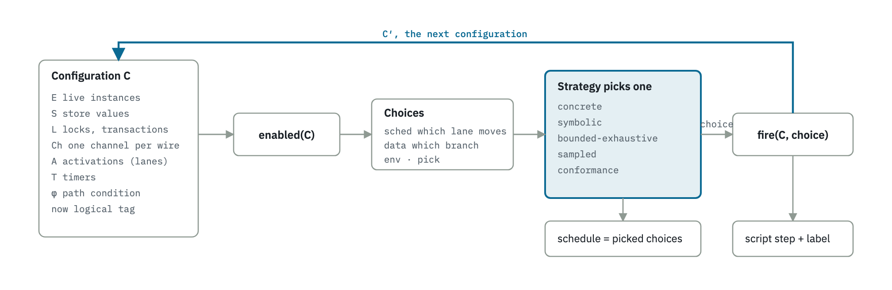
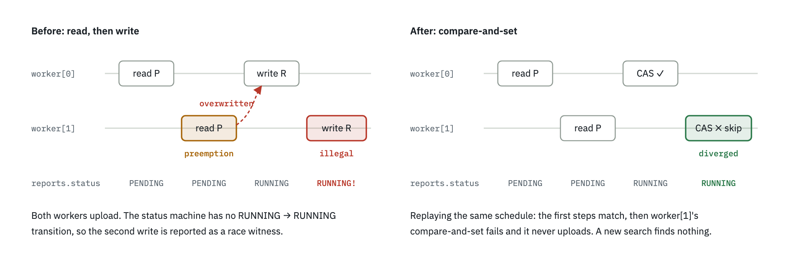
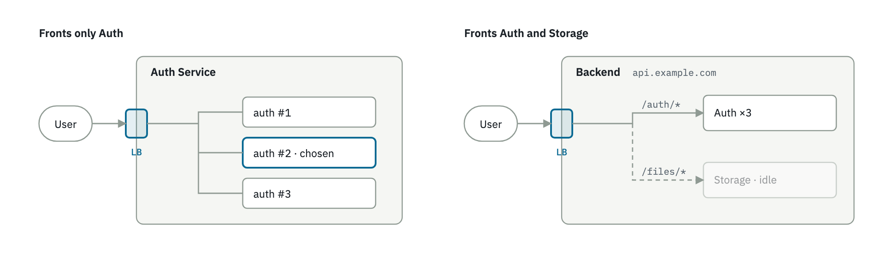
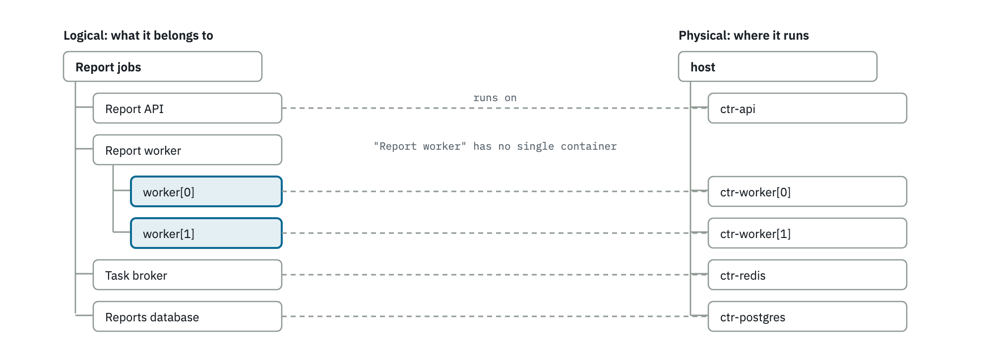
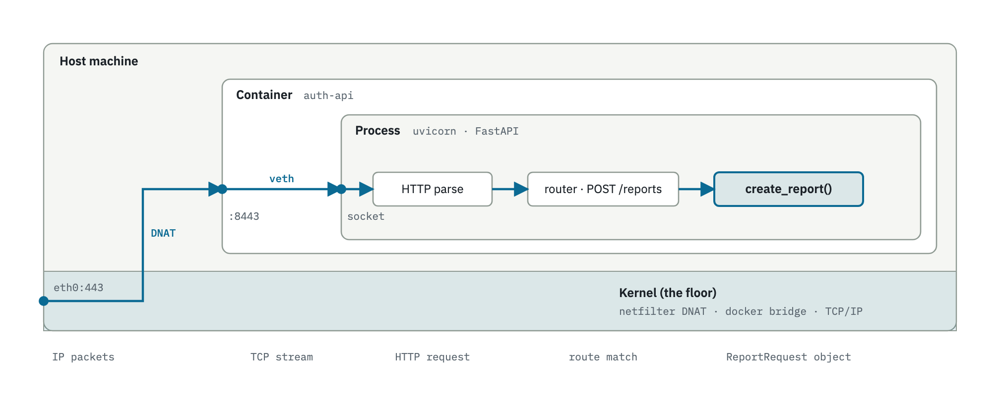
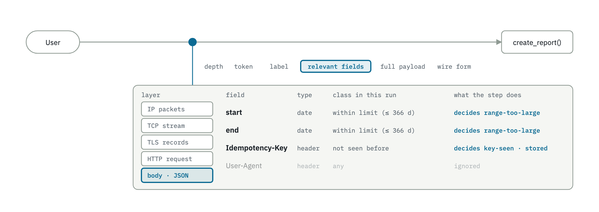
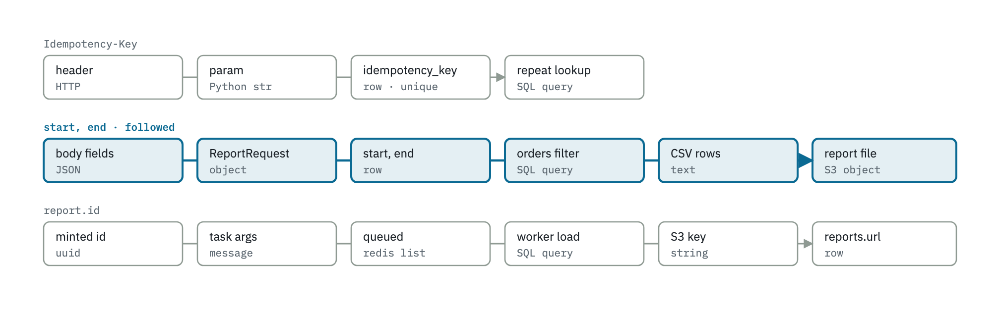
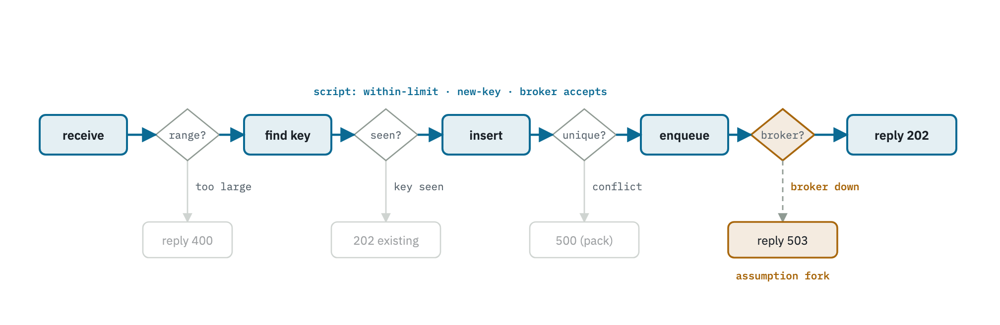

# Mental: specification of the first design

**Status:** design, nothing is built yet. **Date:** 2026-11-13, updated 2026-11-14 with the implementation decisions listed in [the guidelines](guidelines/README.md#accepted-specification-changes).

This document specifies the first version of Mental from first principles. Every term in **bold** on first use is defined in the [glossary](glossary.md). Facts from our own trials and from the research are collected in [findings](findings.md) and cited here as F-numbers.

Each section carries a status:
- **Decided:** confirmed and part of the design.
- **Proposed:** the working answer, not yet confirmed.
- **Later:** designed in outline, not part of version one.
- **Open:** not worked out.

## Contents

1. [What Mental is](#1-what-mental-is)
2. [First principles](#2-first-principles)
3. [Architecture: three tools](#3-architecture-three-tools)
4. [The model](#4-the-model)
5. [Levels and refinement](#5-levels-and-refinement)
6. [`mentalc`: building the model](#6-mentalc-building-the-model)
7. [Packs](#7-packs)
8. [`mentalvm`: running the model](#8-mentalvm-running-the-model)
9. [`mentaldbg`: debugging and showing](#9-mentaldbg-debugging-and-showing)
10. [Products](#10-products)
11. [Version one: scope and build order](#11-version-one-scope-and-build-order)
12. [Later versions](#12-later-versions)
13. [Open questions](#13-open-questions)

---

## 1. What Mental is

**The problem.** To change a system safely, a person needs a picture of it in their head: what the parts are, how a request moves through them, what can go wrong when two things happen at once. Today that picture is rebuilt by reading code, and a coding agent rebuilds its own in every session. Neither picture can be run, checked or shared.

**The answer.** Mental compiles a repository into a **model**: a description of the system that a program can run. On the model you can:

1. **Run a scenario** and get a **trace** of what happens, step by step.
2. **Zoom** into any step to see what it is made of, or out to see what it belongs to.
3. **Search** all orderings of concurrent steps within stated bounds and get a replayable **witness** for each race or dead end.
4. **Change something** (put a load balancer in front of a service, swap one for another, flip an assumption) and see what changes in the traces.
5. **Share the view** with a coding agent: what you have selected is the agent's context.

**What Mental is not.** It does not execute your code, so it works without a running environment. It does not prove correctness: results hold within the model and within stated bounds. It is not a diagram generator: every item in the picture is a record the interpreter uses.

**The running example.** [`examples/report-jobs`](../examples/report-jobs/) is the first target. An API (`POST /reports`) stores a `PENDING` row in Postgres and queues a Celery task through Redis. Two worker replicas take tasks, build a CSV from the `orders` table, upload it to S3 and mark the row `DONE`. It is about 150 lines and contains four real bugs, including a race in which both workers process the same report.

## 2. First principles

Each principle is stated, then justified. Later sections refer to them as P1 to P11.

### P1. A system is a transition system

A **state** is a complete snapshot of the system: where each part is in its code, the value of every variable, the contents of every table, queue and channel. A **transition** is one thing happening: a statement runs, a message is delivered. A **run** is a path from state to state.

Every question about behavior is a question about paths:
- **Safety:** does some path reach a bad state? (Two workers both process report 7.)
- **Liveness:** does every path reach a good state? (Does every requested report end `DONE` or `FAILED`?)

This is the shared foundation of model checking and static analysis, and it is the foundation of Mental.

![One worker's claim code has four steps. Two workers running it give a four-by-four grid of states. Moving right is a worker[0] step, moving down a worker[1] step. The highlighted path reads twice before either writes and ends in a double claim.](images/state-grid.png)

### P2. The state graph is never built; it is generated on demand

The graph of all states is usually infinite: numbers are unbounded, queues grow, rows are created. So the model does not store states. It stores an initial state and a **step function**, and an interpreter produces the next states when asked. Running a scenario walks one path. Searching for bugs walks many paths within bounds.

### P3. The model is an abstraction: conditions and classes, not values

Code is small; its state space is the code multiplied by every value of every variable and by every concurrent copy. Nobody can enumerate that. Static analysis solves this by reasoning about *abstract* states, each standing for many real ones ("`status` is `PENDING`").

Mental's model is such an abstraction:
- a **predicate** stands for a test in the code (`range-too-large`);
- an **input class** stands for all inputs that behave the same ("a range of at most 366 days");
- a **case** stands for all paths through a handler that end the same way.

This keeps the model small enough to run, search and draw. The price is stated openly: parts derived mechanically may allow behavior that cannot happen, and parts written by an LLM may miss behavior that can. P8 exists to keep that visible.

### P4. A system is many small machines that talk through ports

One flat machine for the whole system is correct and unreadable. The useful form is many small machines:
- one **behavior** per **provided port**: what happens when a message arrives there;
- one **lifecycle machine** per **state variable**: which changes are legal;
- **packs** for libraries and outside systems.

They interact only through **ports** joined by **wires**. Concurrency is interleaving: one machine takes a step, then another, in some order. Steps that touch different things can be swapped without changing the result. The orders that matter are those in which two steps touch the same state and at least one writes. That is the definition of a **race**.

### P5. Levels are refinements, and zoom moves between them

The machines form a hierarchy. A coarse machine's single step ("deliver the report") stands for many steps of a finer machine. This is valid when the finer machine **refines** the coarser one: every fine run, viewed from above, is a run the coarse machine allows, and the extra fine steps are invisible above.

Zooming in replaces a step by the steps that implement it. Zooming out does the reverse. Because the relation between levels is recorded and checked, a collapsed view may only hide what is proven safe to hide.

### P6. The model is a program

The whole product follows one analogy, and each tool has the job the analogy gives it:

| Programming | Mental |
|---|---|
| program | the model |
| compiler | `mentalc`: source code becomes the model |
| virtual machine | `mentalvm`: runs the model |
| execution trace | a trace |
| debugger | `mentaldbg`, with the viewer as its screen |

Consequences:
- Every kind of record must have a meaning in the step function. A record the interpreter ignores is decoration and does not belong in the model.
- Debugger features come for free: breakpoints on state, stepping in and out (zoom), stepping backwards (runs are deterministic), "set variable" (what-if).
- Mistakes of the LLM are confined to compile time, where output is checked against the code.

### P7. Each actor does only what it is good at

Research on combining static analysis with LLMs points to one division of labor (F-R1 to F-R3):

| Actor | Owns | Never does |
|---|---|---|
| **Extractors** | structure and completeness: symbols, routes, the call graph, every branch and effect, infrastructure | name an abstraction; guess dynamic behavior |
| **LLM** | local judgment: names, input classes, case summaries, recognizing a mechanism, business wording | remove a branch; decide what is feasible; write a trace |
| **Checkers** | what counts as fact: anchors resolve, every branch is covered, guards do not overlap | accept a claim without an anchor |
| **Interpreter** | running: traces, searches, replays | read source code |

### P8. Every claim is anchored and says how it is known

Every record carries:
- an **anchor**: the file, lines and quoted text that justify it;
- a **provenance**: `inferred`, `attested`, `assumed`, `observed` or `hypothetical`;
- a **source**: which extractor, pack, person or LLM call produced it;
- the **checks** it passed.

A record that fails its checks is not shown as fact. An assumption is never hidden. A hypothetical record is never shown as real.

### P9. Identity comes from the code

A record's ID is built from names in the code: `reports/worker/beh:generate-report`. IDs are never positions ("step 14") and never invented by the LLM, which supplies display names only. So a rebuild keeps IDs stable, and saved runs, breakpoints and user notes stay attached.

### P10. The model and the picture are separate

There are four layers, and information flows only downward:

| Layer | Holds | Example |
|---|---|---|
| Model | facts | the route, the predicate, the wire |
| Run | one execution | binding, schedule, edits, trace |
| View state | what is shown | zoom, collapsed parts, pins, focus |
| Skin | how it looks | shapes, colors, effects |

**The placement test:** if removing something would change what the interpreter computes, it belongs to the model or the run. If it would only change what is seen, it belongs to the view state or the skin.

### P11. What you look at is the agent's context

The selected entity, the scenario being played and the pinned details are held in one **session** that the viewer and the coding agent share. "Zoom into the worker and consider a duplicate delivery" then has an exact meaning for both.

## 3. Architecture: three tools

**Status: Decided.**


| Tool | One job | Reads | Writes | Never |
|---|---|---|---|---|
| **`mentalc`** | compile | a repository, packs, answers from an LLM backend | a complete model, diagnostics, the call ledger | runs the model |
| **`mentalvm`** | interpret | a model, a binding, a schedule, edits | runs: traces, findings, witnesses | reads source code |
| **`mentaldbg`** | debug and show | a model and runs | nothing permanent except saved runs and view state | changes the model |

**Rules between the tools.**
- They communicate through files with a specified format (section 4.9 and 8.6), so each can be built and tested alone.
- `mentalc` output is complete. A build either produces a full model or fails; it never leaves gaps for another tool to fill.
- `mentaldbg` drives `mentalvm` for running and may ask `mentalc` to compile a deeper part when the user zooms into something not yet compiled.
- All three are written in Rust and share libraries for the record format. The interpreter also compiles to WebAssembly so the viewer can run models in the browser.

**The LLM is a setting of the compiler.** `mentalc` asks an **LLM backend** for judgment. The default backend is the user's own coding agent; others are an API, a local model or a headless agent (section 6.5).

## 4. The model

**Status: Decided for the core kinds (4.1 to 4.7); Proposed where marked.**

### 4.1 Shape

The model is a flat set of **records**. Records refer to each other by ID. There is no nesting in storage: an entity's children are the records whose `parent` is that entity.


### 4.2 Fields every record has

| Field | Meaning |
|---|---|
| `id` | the semantic ID (4.3) |
| `level` | the level the record belongs to (section 5) |
| `provenance` | `inferred`, `attested`, `assumed`, `observed` or `hypothetical` |
| `source` | `extractor:<name>`, `pack:<id>@<version>`, `user`, or `llm` with a `call` field naming the ledger entry |
| `checks` | the checks passed |

The record kind is **not stored**: it is the last prefix of the ID and the file the record sits in (4.9). A stored copy could only drift.

### 4.3 Semantic IDs

**Grammar:** `<parent-id>/<kind-prefix>:<slug>`, where the slug is taken from a name in the code.

| Example | Built from |
|---|---|
| `reports/api` | the compose service `api` in project `reports` |
| `reports/api/port:post-reports` | the route `POST /reports` |
| `reports/worker/beh:generate-report` | the Celery task `generate_report` |
| `reports/db/store:report/var:status` | table `reports`, column `status` |
| `reports/api/pred:range-too-large` | a predicate; the slug is derived from the expression's symbols, the display name comes from the LLM |

Rules:
- An ID never contains a position or a counter. The one exception is an instance's replica number (`reports/worker[0]`): it comes from configuration (`replicas: 2`), not from the order of the code, so it is stable across rebuilds. `[n]` is allowed on instance IDs only.
- **Slugs** are ASCII `[a-z0-9]+(-[a-z0-9]+)*`, with no escaping. A code name becomes a slug through one function (lowercase, every run of other characters becomes `-`). A slug made only of digits is rejected.
- **Collisions** are resolved by adding another code name to the colliding IDs only, never by a counter.
- **One text form.** An accepted ID is canonical: parsing it and printing it gives back the same bytes. A non-canonical ID is rejected, never normalized.
- **Only full IDs are stored.** Every reference in a stored record, including guards, steps, nodes and classes, is a complete ID. Short forms (`pred:range-too-large`, `n:load`) exist only in what people read: the viewer and the terminal.
- A content hash is stored beside a record as a cache key. It is never part of the identity.
- Renaming a symbol in code changes the ID. The compiler reports renames it can detect so saved runs can be migrated.

**The ID of every kind:**

| Kind | Pattern | Example |
|---|---|---|
| entity | `<parent>/<slug>`, or `<slug>` at the root | `reports/worker` |
| store (an entity) | `<parent>/store:<slug>` | `reports/db/store:report` |
| actor (an entity) | `<system>/actor:<slug>` | `reports/actor:operator` |
| port | `<entity>/port:<slug>` | `reports/api/port:post-reports` |
| wire | `<from-port>/wire:<to-entity-slug>-<to-port-slug>` | `reports/api/port:enqueue-generate/wire:broker-tasks` |
| instance | `<entity>[<n>]` | `reports/worker[1]` |
| state variable | `<store>/var:<slug>` | `reports/db/store:report/var:status` |
| machine | `<state-variable>/machine:lifecycle` | `reports/db/store:report/var:status/machine:lifecycle` |
| predicate | `<entity>/pred:<slug>` | `reports/api/pred:range-too-large` |
| characteristic | `<port>/in:<slug>` | `reports/api/port:post-reports/in:range` |
| input class | `<characteristic>/class:<slug>` | `reports/api/port:post-reports/in:range/class:too-large` |
| behavior | `<entity>/beh:<slug>` | `reports/worker/beh:generate-report` |
| case | `<behavior>/case:<slug>` | `reports/worker/beh:generate-report/case:skip` |
| node | `<behavior>/n:<slug>` | `reports/worker/beh:generate-report/n:claim` |

Cases, input classes and nodes are **embedded**: they live inside their record's line but have IDs of their own, because other records reference them (a machine's `by` names a node).

**Every ID is unique.** Two records, cases or classes with the same ID are an error, even when the two are identical: the model has one writer, so a duplicate is a writer bug. A node may appear in several cases of its behavior, because cases are paths through the same nodes; every appearance of one node carries the same fields.

### 4.4 Anchors

Anchors are stored apart from the records, in `anchors.jsonl`, so moving code without changing it touches only that file (F-S9).

```json
{"id":"reports/api/beh:post-reports/n:find-existing","path":"app/api.py","lines":"25",
 "quote":"existing = s.query(Report).filter_by(idempotency_key=idempotency_key).one_or_none()","status":"exact"}
```

An anchor's `status` is `exact` (the quote matches the file), `moved` (found elsewhere in the file) or `broken`. A record with a broken anchor fails the anchor check.

### 4.5 Structure records

**`entity`** — anything with a boundary.

| Field | Meaning |
|---|---|
| `type` | `Service`, `Process`, `Container`, `Host`, `Store`, `Actor`, `External`, `Function`, `Mechanism`, or a type from a pack |
| `name` | display name |
| `parent.logical`, `parent.physical` | the parent in each **facet** |
| `replicas` | for a type with several instances |

*In the step function:* an entity is a namespace for ports and state; its instances appear in the configuration.

**`port`** — an interaction point on an entity's boundary.

| Field | Meaning |
|---|---|
| `parent` | the owning entity |
| `direction` | `provides` or `requires` |
| `protocol` | `http-route`, `sql`, `celery-task`, `s3-api`, `call`, … |
| `message` | the message schema: layers, payload type, headers |
| `exposure` | `external` or `internal` (provided ports only) |
| `trigger` | what starts it: `http`, `task`, `schedule`, `cli`, `call` |
| `handler` | the symbol that handles it, for provided ports of user code |

*In the step function:* a message arriving at a provided port starts an **activation** of that port's behavior. A send node puts a message on the wire attached to a required port.

**`wire`** — a connection between two ports.

| Field | Meaning |
|---|---|
| `wire` | `assembly` or `delegation` |
| `from`, `to` | the two ports |
| `channel` | `order: fifo \| bag`, `lossy`, `dup`, `bounded: n` |
| `adapter` | a stateless change of form, if any |
| `match` | how the wire was found: `exact` (a key matched), `heuristic`, `assumed-env` |

*In the step function:* each wire instance is one channel in the configuration. Delivery takes a message from the channel to the receiving port. `lossy` and `dup` add drop and duplicate choices.

**`instance`** — a concrete copy of an entity, created by the load phase.

| Field | Meaning |
|---|---|
| `of` | the entity |
| `on` | where it runs (physical facet) |
| `config` | values bound for this instance: environment, isolation level, concurrency |

### 4.6 State records

**`state_var`** — the part of a **store** that behavior depends on.

| Field | Meaning |
|---|---|
| `parent` | the store entity |
| `domain` | the possible values, as an enum or as classes |
| `scope` | `per-row`, `per-table`, `per-instance`, `global` |
| `constraints` | `unique`, `not-null`, foreign keys |

The nodes that write a state variable are not stored on it: they are derived from the write nodes of behaviors, so a stored list could only drift.

**`machine`** — the lifecycle of one state variable.

| Field | Meaning |
|---|---|
| `var` | the state variable |
| `initial` | the value on creation |
| `transitions` | each with `from`, `to`, `by` (the writing node) and `guard` |

*In the step function:* every write is checked against the machine. A write that is no legal transition stops the run as an **illegal write**.

```json
{"id":"reports/db/store:report/var:status/machine:lifecycle","var":"reports/db/store:report/var:status",
 "initial":"PENDING",
 "transitions":[
  {"from":"PENDING","to":"RUNNING","by":"reports/worker/beh:generate-report/n:claim"},
  {"from":"RUNNING","to":"DONE","by":"reports/worker/beh:generate-report/n:mark-done"},
  {"from":"RUNNING","to":"PENDING","by":"reports/worker/beh:generate-report/n:mark-retry"},
  {"from":"RUNNING","to":"FAILED","by":"reports/worker/beh:generate-report/n:mark-failed"},
  {"from":"RUNNING","to":"PENDING","by":"reports/worker/beh:requeue-stuck/n:reset"},
  {"from":"FAILED","to":"PENDING","by":"reports/cli/beh:retry/n:reset"}]}
```

### 4.7 Behavior records

**`predicate`** — a named yes-or-no fact.

| Field | Meaning |
|---|---|
| `name` | display name |
| `expr` | the code's own test |
| `over` | what it is about: a message field, a state variable, a config key, a port's response |
| `scope` | how long its value holds: `per-activation`, `per-run`, `state` (re-read from state each time) |
| `decided_at` | the node kind that decides it: `receive`, `read`, `write`, `response`, `env` |
| `equals` | for a predicate over a state variable with an enum domain: the value it tests for, such as `PENDING` |

Predicates with `equals` on the same variable cannot vary independently: at most one of them is true. The guard-algebra check (6.7) therefore treats that variable as **one dimension** over its domain values, not as independent yes-or-no facts, and never reports a gap or an overlap that cannot happen.

**`characteristic`** — one way a port's input varies, with its **input classes**.

```json
{"id":"reports/api/port:post-reports/in:range","parent":"reports/api/port:post-reports",
 "about":"fields start, end",
 "choices":[{"id":"reports/api/port:post-reports/in:range/class:within-limit","name":"at most 366 days",
             "when":"!reports/api/pred:range-too-large","tags":["base"]},
            {"id":"reports/api/port:post-reports/in:range/class:too-large","name":"longer than 366 days",
             "when":"reports/api/pred:range-too-large"}]}
```

Classes of one characteristic must cover every input and must not overlap. One class is tagged `base`: the default when a scenario says nothing.

**`behavior`** — what one provided port does. Two levels of detail (`lod`):

*Summary:* a list of **cases**.

```json
{"id":"reports/worker/beh:generate-report","port":"reports/worker/port:task-generate-report","lod":"summary",
 "cases":[
  {"id":"reports/worker/beh:generate-report/case:skip","when":"!reports/worker/pred:status-is-pending",
   "steps":[{"node":"reports/worker/beh:generate-report/n:load","kind":"read","var":"reports/db/store:report/var:status",
             "decides":["reports/worker/pred:status-is-pending"]}],
   "outcome":"ack"},
  {"id":"reports/worker/beh:generate-report/case:done",
   "when":"reports/worker/pred:status-is-pending & reports/worker/pred:upload-ok",
   "steps":[{"node":"reports/worker/beh:generate-report/n:load","kind":"read","var":"reports/db/store:report/var:status",
             "decides":["reports/worker/pred:status-is-pending"]},
            {"node":"reports/worker/beh:generate-report/n:claim","kind":"write","var":"reports/db/store:report/var:status",
             "value":"RUNNING","evidence":["commit"]},
            {"node":"reports/worker/beh:generate-report/n:build-csv","kind":"read","store":"reports/db/store:order"},
            {"node":"reports/worker/beh:generate-report/n:upload","kind":"send","port":"reports/worker/port:storage",
             "decides":["reports/worker/pred:upload-ok"]},
            {"node":"reports/worker/beh:generate-report/n:mark-done","kind":"write","var":"reports/db/store:report/var:status",
             "value":"DONE","evidence":["commit"]}],
   "outcome":"ack"}]}
```

*Full:* a graph of `nodes` and guarded `edges`, close to the statements. It is compiled when someone zooms in, or ahead of time for ports open to the outside.

Rules for behaviors:
- **Cases partition.** The guards of one behavior cover every situation and do not overlap. A case with no guard is the `otherwise` case: it covers what the other cases leave, and reports `unknown`. A behavior with a single case has no guard.
- **Guards are small.** A guard uses only `!`, `&`, `|`, parentheses and full predicate IDs. A guard that names a predicate that does not exist is an error, never read as false.
- **The partition check enumerates.** The check tries every assignment of the dimensions a behavior's guards mention (a plain predicate is one yes-or-no dimension; a state variable tested with `equals` is one dimension over its values). Above 16 dimensions it reports `guard-check-too-large` instead of running or skipping; the largest behavior in our trial mentions 5 predicates.
- **Ordered reads.** A node lists the predicates it `decides`. The interpreter may not use a predicate before the node that decides it. This is how "the upload has not happened yet" stays true during a run (F-S3).
- **Evidence, not claims.** Nodes that touch shared state carry `evidence` of what the code does for atomicity (a transaction, a lock, a conditional update). The compiler records evidence; the interpreter computes atomicity from it.
- **Frameworks own what they do.** Request validation (a 422 answer) and unhandled exceptions (a 500 answer) belong to the framework's pack, not to the handler's behavior (F-S1).

Node kinds: `read`, `write`, `send`, `call`, `reply`, `branch`, `loop`, `lock`, `unlock`, `begin`, `commit`, `spawn`, `wait`, `raise`.

### 4.8 Records above the core

**Status: Proposed.** These kinds are needed for the upper levels and for what-if questions.

| Kind | Purpose | Section |
|---|---|---|
| `term` | one word of the project's glossary, with anchors and levels | 6.3 |
| `level` | one level: vocabulary, the level below, abstraction function, step map, invariants | 5 |
| `mechanism` (an entity type) | a lock, retry policy, claim | 5.4 |
| `assumption` | a predicate bound by default, with reason and alternatives | 8.4 |
| `variation_point` | a place where the structure can differ, with options | 8.8 |

### 4.9 Storage

**Status: Decided for the core files (2026-11-14). Alternatives are in section 12.**

```
.mental/                       not committed (in .gitignore)
  model/                       one sorted JSONL file per record kind
    format.json                {"format":1}: the format version of every file in this folder
    entities.jsonl  ports.jsonl  wires.jsonl  instances.jsonl
    state_vars.jsonl  machines.jsonl
    predicates.jsonl  characteristics.jsonl  behaviors.jsonl
                               terms.jsonl, levels.jsonl and the other kinds of 4.8 arrive with them
  anchors.jsonl                record ID → file, lines, quote
  diagnostics.jsonl            findings, gaps, assumptions, failed checks
  packs.lock                   packs used, with versions and hashes
  calls.jsonl                  the LLM call ledger (6.6); holds hashes of answers, not their text
  answers/                     every raw LLM answer, stored by its content hash
  cache/                       accepted answers, keyed by task content (6.8)
  runs/                        saved runs (8.6)
```

- **Text is the stored form.** One record per line, sorted by ID in byte order, so two models can be compared with ordinary text tools and an LLM can read and write them.
- **One kind per file.** A record whose ID kind does not belong in the file it sits in is an error. Stores are entities, so they sit in `entities.jsonl`.
- **One canonical form per line.** Fields appear in a fixed order; an absent optional field or an empty set is omitted, never written as `null` or `[]`; set-valued fields (`checks`, `tags`, `decides`, `evidence`) are sorted and free of repeats; ordered lists (`steps`, `transitions`, `cases`) keep their order because it means something. Every file ends with a newline, and a file is rewritten only when its bytes change.
- **Strict reading.** An unknown field, an unknown kind or a missing required field is an error. There is no catch-all field.
- **One format version, no migrations.** `format.json` holds one number for the whole model. A model written in another format is an error that says "rebuild"; there is no migration code, because the model can always be rebuilt.
- **The model is derived, never edited by hand and never merged.** It is a function of the code, the compiler version, the packs and the LLM answers. After a merge, the merged code is compiled again.
- **A derived index** (for example SQLite) may be built beside the text for speed; it can always be rebuilt.


## 5. Levels and refinement

**Status: the ladder is Decided; the `level` record and its checks are Proposed.**

### 5.1 The ladder of version one


| Level | Entities | One step is | Data seen | Comes from |
|---|---|---|---|---|
| **Business** | customer, report | a business event: "report delivered" | report status in business words | glossary and LLM, checked against the level below |
| **System** | the product, its users, outside services | an interaction between parties | what flows between parties | the close phase |
| **Services** | services, queues, stores | a message | request and task payloads | extractors, infrastructure files, packs |
| **Components** | handlers, modules | a call or a case | objects and arguments | extractors and the LLM, one port at a time |
| **Mechanisms** | locks, claims, retry policies | acquire, test, retry | holder, attempts | packs, and LLM recognition |
| **Statements** | functions, variables | a statement | variable values as classes | extractors |

The **physical side** (process, container, host) says where things run. It meets the logical side where a service runs as a process (**allocation**). Version one models the physical side down to the container and process, from infrastructure files.

### 5.2 What a level is made of

A level is a record with these parts (from the survey of how other fields relate levels, F-R4):

| Field | Meaning | Checked by |
|---|---|---|
| `vocabulary` | the entities, state variables, predicates and step kinds allowed at this level | the barrier check |
| `below` | the level or levels it refines | — |
| `pattern` | how it relates to the level below: `group`, `summarize`, `atomize`, `hide`, `assume` | that pattern's check |
| `abstraction` | one expression per upper state variable, over lower state | accepted or rejected one by one |
| `step_map` | which lower steps make up each upper step; which lower steps are invisible | the pair check |
| `invariants` | properties in this level's words | bounded search |
| `actors` | for people and outside systems: what they *may* do | used by the interpreter |

**Two operations build every level:**
1. **Group:** draw a box around things that exist (functions into a component, processes into a service). Cheap and mostly mechanical.
2. **Abstract:** replace several lower steps by one named upper step and record how ("claim the report" = read `status`, test it, write `RUNNING`).

### 5.3 Checks between levels

- **Pair check.** Each pair of adjacent levels is checked by running the lower level and projecting it upward: exactly one group of lower steps changes the upper state, and it does so by the upper step the map names. Checks run per pair, never from top to bottom in one go (F-R4).
- **Barrier check.** A behavior at a level mentions only that level's vocabulary. A violation is a finding ("the business step reads a database column directly").
- **Coverage.** Every lower step is either mapped to an upper step or marked invisible (F-Z2).
- **Invariants.** Each invariant is tested by bounded search at the level that states it.

When a pair check fails because another activation got in between, that is a **race reported at the level where the user thinks**: "a report is delivered at most once" fails at the business level, and the cause is found by zooming down.

### 5.4 Mechanisms

A **mechanism** is the level the code never names. A lock is not a line of code; it is an entity with states (free, held) used by many lines.

- **Known mechanisms** come from packs: Celery's retry policy (`max_retries=3`) becomes an entity with a counter and a limit.
- **Improvised mechanisms** are recognized by the LLM from a state variable, its write sites and their guards. In report-jobs, "read `status`, test for `PENDING`, write `RUNNING`" is a **claim**: the column is used as a lock.

A proposed mechanism must have (1) state that persists, (2) a lifecycle and (3) an invariant other code relies on. Two checks then apply: every write site is a legal move of the lifecycle, and the steps the mechanism needs to be atomic are atomic. In report-jobs the second check fails, and that failure *is* the race.

### 5.5 What our own trial showed

A hand-written version of one race at seven levels (F-Z1 to F-Z8) fixed these design points:
- Zoom maps by **step identity**, never by position: refined steps of two upper steps interleave.
- A level adds detail only where its vocabulary applies, so **"unchanged at this level" is a first-class notion**.
- Entities split as well as steps, through a parent link per level.
- **Each problem has a level where it can be named.** Upper levels show only symptoms, with a marker that the cause is further down.
- Upper-level data is often an **aggregate** ("deliveries: 2"), not a copied field.
- The refinement map belongs **in the model** (each node names the upper step it implements), so every run can be shown at every level without extra data.

---

## 6. `mentalc`: building the model

**Status: the pipeline and the division of labor are Decided; phases 4, 5, 7 and 11 are Proposed in their details.**

This is the current focus of the project: **building the model from one repository.**

### 6.1 Inputs, output, commands

| | |
|---|---|
| **Inputs** | one repository at one commit (source code, infrastructure files, docs, lockfiles); packs for its libraries; answers from an LLM backend |
| **Output** | `.mental/` as laid out in 4.9: a complete model, anchors, diagnostics, the pack lock, the call ledger |

| Command | Does |
|---|---|
| `mentalc init` | writes a config file and adds `.mental/` to `.gitignore` |
| `mentalc build` | runs the pipeline; `--full` also compiles every full-detail behavior |
| `mentalc build --unit <id>` | compiles one deeper part on demand (used when zooming) |
| `mentalc check` | re-runs the checks on an existing model without calling an LLM |
| `mentalc diff <a> <b>` | compares two models at the level of behavior |
| `mentalc rebuild --role <role> --with <llm>` | recompiles what one LLM role produced, with another LLM (6.6) |
| `mentalc task next`, `mentalc task submit` | the task protocol for the `agent` backend (6.5); also offered as MCP tools by `mentalc mcp` |

Every command has a `--json` form, which prints the model's own JSON (diagnostics as diagnostic records).

`--offline` forbids every LLM call: answers come from the cache only, and a miss is an error. `mentalc check` is always offline.

**Exit codes.** Every tool exits with:

| Code | Means |
|---|---|
| 0 | success |
| 1 | the command ran and found error-level problems: failed checks, repairs exhausted, a violation found by search |
| 2 | the tool itself failed: I/O, configuration, the LLM backend, a cache miss when offline, bad usage |

### 6.2 The pipeline


| # | Phase | Reads | Writes | LLM |
|---|---|---|---|---|
| 1 | **Detect** | manifests, file types, lockfiles | the domain (always software for now), languages, frameworks, the level ladder to use | no |
| 2 | **Extract** | source and infrastructure files | the skeleton and the obligations (6.2.1) | no |
| 3 | **Resolve packs** | lockfiles, container images | `packs.lock`; pack summaries for later phases | no |
| 4 | **Vocabulary** | docs, identifiers, schema | `term` records (6.3) | yes |
| 5 | **Group** | call graph, packages, infrastructure | services (mechanical) and components (boxes from packages and call-graph clusters; names from the LLM) | names only |
| 6 | **Compile** | one compile unit at a time | predicates, input classes, behaviors, lifecycle machines (6.4) | yes |
| 7 | **Mechanisms** | state variables, write sites, packs | mechanism entities and their step maps (5.4) | for improvised ones |
| 8 | **Link** | call sites, config values | wires between ports; slots filled; pack predicates bound by config | no |
| 9 | **Load** | infrastructure files | instances with their config | no |
| 10 | **Close** | ports nothing connects to | actors, drivers and stubs, so the model runs on its own | no |
| 11 | **Levels** | everything below | the system level (mechanical) and the business level: abstraction, step map, invariants (section 5) | for business |
| 12 | **Check** | the whole model | diagnostics; a failed check sends a repair back to the phase that produced the record | no |

After phase 12 the model is written. Phase 11 comes after Close because its checks need a model that can run.

#### 6.2.1 Extract, in detail

Extract produces facts and nothing else. Its steps, from the bottom:

| Step | Produces | With |
|---|---|---|
| Parse | a syntax tree per file | ruff's Python parser (`ruff_python_parser`, `ruff_python_ast`), pinned to an exact version; its types never leave the extractor |
| Resolve names | symbol table, import graph, call graph | Mental's own resolver, driven by the type rows of packs (section 7). What it cannot resolve is recorded as `unresolved` with a reason, never guessed |
| Control flow | per function: branches, loops, exception paths. Each branch point is an **obligation** | extractor |
| Effects | per call that reaches outside: database read or write, send, HTTP call, file, clock | extractor plus packs (the pack says `session.commit()` writes) |
| State variables | each persistent value with all its write sites | extractor plus the ORM pack |
| Entry points | provided ports: routes, tasks, schedules, commands | framework packs, through **slots** |
| Infrastructure | containers, replicas, environment, published ports, which process runs which code | `docker compose config` and similar renderers |

On report-jobs this yields 5 files, a call graph, 6 entry points (2 routes, 2 Celery tasks, 1 schedule, 1 command) and 2 state variables (F-S10).

**A call-graph edge** is one distinct pair (calling function, called function) where both functions are defined in the repository; several calls between the same pair count once. A call that reaches a library through a pack becomes an effect or a slot, not an edge. A call that cannot be resolved is listed as `unresolved` and counted apart. The trial's count of 41 edges was made before this definition and is measured again when the extractor first runs on report-jobs.

**Why not tree-sitter or a language server.** A typed syntax tree makes semantic extraction direct, the parser is pure Rust, and a SCIP indexer or a language server would bring Node or a Python environment, against running locally with nothing else installed. tree-sitter stays an **Experiment**: it is revisited if keeping up with ruff's releases costs more than about an hour a month, or when a second language is scheduled.

**Why static tools do this and not the LLM:** static call graphs are markedly more complete than LLM-made ones, and an LLM asked to decide which branches are possible drops real bugs (F-R1, F-R3). The LLM never sees a job where missing something is silent.

#### 6.2.2 Link, Load, Close

- **Link** joins each required port to the provided port it reaches. Most links are exact key matches: a task name, a URL path against a route, a `DATABASE_URL` host against a compose service. A link that is a guess is marked `heuristic`. Link also binds pack predicates from call sites: `max_retries=3` fixes when "retries exhausted" is true, and cases that can no longer match are removed. What cannot be resolved becomes an **assumption**.
- **Load** creates **instances**: `replicas: 2` gives `worker[0]` and `worker[1]`. Config that makes a port unreachable (`WEBHOOK_URL` unset) is recorded as a binding; the branch stays in the model for other deployments (F-S6).
- **Close** makes the model runnable alone. For every provided port open to the outside it adds a **driver** that can send any input class. For every required port leading outside it adds a **stub** that answers with any declared outcome. Users, operators and the clock become **actors**.

### 6.3 Vocabulary: the project's glossary

**Status: Proposed.**

Names are where LLM output drifts most. To keep one word meaning one thing at every level, `mentalc` builds one glossary per model before it compiles anything, and every later LLM task receives the relevant slice.

1. **Harvest.** Read the docs (README, design notes, API descriptions, CLI help, docstrings) and extract candidate terms with their definitions quoted from the source.
2. **Anchor.** Match each term to code: identifiers, tables and columns, enum values, routes, queue names. A checker accepts an anchor only if the symbol exists.
3. **Classify.** Tag each term: concept (*report*), state (*pending*), event (*report requested*), actor (*operator*), mechanism (*claim*), quantity (*retry limit*).
4. **Assign levels** from where the anchors land. One word with two senses on two levels becomes two terms.
5. **Use everywhere.** When the LLM names anything, it picks a glossary term first. A new name is allowed but flagged.

```json
{"id":"reports/term:report","name":"report","sense":"a CSV of orders for a date range, delivered to S3",
 "term_kind":"concept","levels":["business","services"],
 "code_anchors":["app/api.py:POST /reports","app/models.py:Report"]}
```

**The code wins over the docs.** A documented term with no code anchor, or a central code concept with no documented term, is reported as a finding. Without docs (report-jobs has none) the glossary is built from identifiers, the schema, routes and help text alone.

### 6.4 Compile: one port at a time

A **compile unit** is the smallest piece of work the LLM sees, usually one provided port. It contains:
- the handler's code slice;
- its obligations;
- summaries of what it calls, from packs or from units compiled earlier, *instead of* that code;
- the glossary slice;
- the IDs already in scope.

Units are compiled **bottom-up along the call graph**, so each summary builds on those beneath it.

The answer must contain, in this order: a short analysis, **predicates**, **input classes**, **cases**. For each state variable a separate task proposes its **lifecycle machine**.

**What the LLM may not do:** drop an obligation, declare a branch impossible, or invent an ID.

**Ahead of time and on demand.** A normal build compiles the structure, every port's summary behavior, and the full-detail behavior of ports open to the outside. Deeper full-detail behaviors are compiled when someone zooms into them (`mentalc build --unit`).

Cost on report-jobs, estimated by hand: 15 LLM calls for a first build, 3 for a rebuild after a one-line fix (F-S10).

### 6.5 LLM backends

**Status: the pluggable interface is Decided, synchronous since 2026-11-14; the list of backends is Proposed.**

Every LLM step is a **task** that `mentalc` writes and a backend answers. Prompts, answer shapes, checks, repairs and the cache all stay in `mentalc`, so the result is judged the same way whichever backend answered.

```rust
struct Task {
    id: TaskId,                 // the hash of the task's content
    role: Role,                 // vocabulary, port-behavior, lifecycle, mechanism, business, repair, …
    prompt: PromptRef,          // template name, version and content hash
    inputs: Vec<Input>,         // code slices by anchor and content hash, summaries, glossary slice
    answer_schema: JsonSchema,  // the exact shape of the answer
}

// The build is a state machine with two operations; every backend drives it.
fn next_task(&mut self) -> Option<RenderedTask>;                  // the next task to answer, or none when done
fn accept(&mut self, task: TaskId, raw: RawAnswer) -> Verdict;    // check the answer: accepted, a repair task, or failed

// Backends that call an LLM themselves implement one synchronous method.
trait Backend {
    fn caps(&self) -> Caps;                                        // LLM model ID if known, context size, tool use
    fn complete(&self, task: &RenderedTask) -> Result<RawAnswer, BackendError>;
}
```

**Why synchronous.** A build of report-jobs makes about 15 calls, which needs no concurrency; version one has no async runtime, which would bring dozens of crates; and the `agent` backend inverts control, so it cannot be a function that is awaited.

| Backend | How it works | Use |
|---|---|---|
| **`agent`** (default) | The user's coding agent pulls work: `task next` returns a task, the agent thinks (and may read more code with its own tools), `task submit` returns the answer. `mentalc` checks it and replies with a repair or the next task. It is not an implementation of `Backend` but the command and MCP surface over `next_task` and `accept`. No session file is kept: the build's state is the cache, the ledger and repair counts derived from the ledger, and `task next` recomputes the cheap phases. Works with any agent that can run a command or call an MCP tool. | everyday local builds, inside an interactive agent session; needs no API key |
| **`api`** | `mentalc` calls an LLM API itself: Anthropic, OpenAI or any compatible endpoint | automated builds |
| **`local`** | the same, against a local server such as Ollama or vLLM | offline work, private code |
| **`agent-cli`** | `mentalc` starts a headless agent as a subprocess (`claude -p`, `codex exec`) | a terminal build with no agent session open |
| **`replay`** | answers come only from stored answers, looked up by task; a missing answer is an error | tests and CI, which never call a live model; `--offline` builds |

Rules:
- **A backend per role.** The config maps each role to a backend and an LLM, so a small LLM can name components while a strong one recognizes mechanisms.
- **Tasks are self-contained.** An agent may explore further; no task depends on it.
- **No weaker model on failure.** If a task cannot be answered (no backend, a failing provider, repairs exhausted), the build fails with a clear error. It never writes a model with the LLM parts missing, because a degraded model would later be read as complete.
- **MCP sampling is not used:** the protocol deprecated it and Claude Code never supported it (F-X1).
- **The MCP tools are fixed.** `mentalc mcp` offers `mental_task_next` and `mental_task_submit(task_id, answer)`, and nothing that changes per task: the answer schema travels inside the task. A failed check, an unknown task or exhausted repairs is a normal result marked `isError: true` with the repair text; only protocol faults are protocol errors. The server is synchronous over standard input and output and answers both the 2025-11-25 and the 2026-07-28 revisions of the protocol.

### 6.6 The call ledger

**Status: Decided.**

Every LLM call, failed calls and repairs included, appends one complete line to `.mental/calls.jsonl` before its records are used, and every record the call produced points to it. Two reasons: when a better or cheaper LLM appears, the affected parts can be rebuilt; and LLMs can be compared on the same job. The raw answer is stored in `.mental/answers/` by its content hash, and the ledger holds only the hash. A torn last line is detected when the ledger is opened. Repair counts are derived from `repair_of`, not kept anywhere else.

```json
{"id":"call:port-behavior/generate-report#1","role":"port-behavior","unit":"reports/worker/port:task-generate-report",
 "backend":"agent","llm":{"id":"claude-opus-5-5","provider":"anthropic","known_by":"harness"},
 "prompt":{"template":"compile-unit/port-behavior","version":3,"hash":"h:9b2e"},
 "task":"h:51c0","answer":"h:e07d",
 "produced":["reports/worker/beh:generate-report","reports/worker/pred:upload-ok"],
 "checks":{"anchor":"pass","coverage":"pass","guard_algebra":"pass","agreement":"pass"},
 "cost":{"input_tokens":18400,"output_tokens":2900,"seconds":41}}
```

`known_by` is `configured`, `harness` or `self-reported`. `repair_of` is omitted when the call is not a repair.

**Roles:** `vocabulary`, `component-grouping`, `port-behavior`, `lifecycle`, `mechanism`, `business`, `repair`, `scenario-binding`.

**`known_by`** records how the LLM's identity is known: `configured` (set explicitly), `harness` (reported by the agent's software) or `self-reported` (stated by the LLM itself, the weakest).

**Rebuilding.** The compile cache is keyed by the task's content (6.8), never by the LLM, so changing the LLM invalidates nothing by itself. A rebuild is an explicit request: `mentalc rebuild --role mechanism --with <llm>`. The difference between the two resulting models, together with the check results, is itself an evaluation of the new LLM.

### 6.7 Checks

Checks decide what counts as fact. A failed check produces a **repair** task naming exactly what failed; after a set number of failed repairs the build fails.

| Check | Rule | Applies to |
|---|---|---|
| **Structural** | the record has the right shape; every referenced ID exists | every record |
| **Anchor** | the anchor's quote is found in the file | every record |
| **Coverage** | every obligation of the handler appears in some predicate or case | behaviors |
| **Guard algebra** | the cases of a behavior, and the classes of a characteristic, cover everything and do not overlap | behaviors, input classes |
| **Composition** | every outcome a callee can produce is handled by its caller; every required port is wired or stubbed | wires, behaviors |
| **Summary agreement** | a summary behavior agrees with its full graph | behaviors with both levels of detail |
| **Sample agreement** | several independent answers to the same task agree | LLM answers for chosen roles |
| **Machine** | every write site is a legal move of the lifecycle; no state is **stranded**, meaning its only exits need a message that may never exist (F-S7) | state variables |
| **Atomicity** | a check-then-act on shared state has evidence that makes it atomic | behaviors that write state |
| **Refinement pair** | section 5.3 | adjacent levels |
| **Barrier** | section 5.3 | levels |

The first six need no interpreter. Atomicity is predicted statically and confirmed by `mentalvm` search.

### 6.8 Incremental builds

- **The cache key is content.** The compile cache stores each accepted answer under the hash of: the role, the template's name, the template's content hash, the answer schema's hash, and the hashes of the exact input slices placed in the prompt (code by the hash of its slice, callee summaries by their own content hash). The LLM's identity never enters the key. An edit outside every slice invalidates nothing; an unchanged callee summary stops recompilation above it.
- **Templates cannot change silently.** A `prompts.lock` pins each template's version and content hash; a test fails when a template changes without a version bump, so the version recorded in the ledger always means something.
- **Paid answers are kept safe.** Only accepted answers are cached, and checks re-run on every cache hit. Nothing is evicted by age. A corrupt entry is reported and treated as a miss. A miss in `mentalc check` or with `--offline` is an error.
- **Every recompile is explained.** `build --json` lists each cache miss with the input hash that changed.
- After a code change, only units whose inputs changed are recompiled. Glossary terms, predicates and level maps are kept and re-checked, not regenerated.
- Sharing models between machines is **Later** (section 12).

### 6.9 What a build of report-jobs should find

These are the acceptance facts for the compiler (F-S11):

| Finding | Kind | Found by |
|---|---|---|
| Two workers can both claim the same report | race | atomicity check; confirmed by search |
| `requeue_stuck` can overwrite `DONE` with `PENDING` | race | atomicity check |
| Two requests with the same idempotency key: one gets a 500 | unhandled outcome | composition check |
| A `PENDING` row with no task in flight is never picked up | stranded state | machine check |

## 7. Packs

**Status: the format is Decided; where packs come from in version one is Proposed.**

A **pack** is a model of a library, framework, runtime or outside system, written in the same record format as the model of user code.

**Why packs are needed.** The repository's code says `session.commit()`. Nothing in the repository says that this writes rows, that it is a transaction boundary, or which isolation level applies. A pack says so, once, for everyone.

| A pack contains | Example |
|---|---|
| entity types and their ports | Celery's worker and consumer; Postgres's `sql` port |
| behaviors at summary detail, keyed by input classes | `Task.retry`: re-queue if retries remain, else fail |
| **slots**: where the framework calls user code | FastAPI's route handler; Celery's task function |
| effect rules for the extractor | `Session.commit()` is a database write and ends a transaction |
| channel rules | with `task_acks_late = True` on Redis, delivery is at-least-once |
| known mechanisms | retry policy, connection pool |

**The extractor's part is rows.** What the extractor reads from a pack (types, effects, slots, the exceptions a call raises, config bindings) is written as rows in CodeQL's models-as-data style: each row names a package, a type or function through a closed access-path grammar, with `Decorates` and `WithArg` added for slots. Behaviors, channels and mechanisms stay records in the model's format. The rows are Mental's own content; only the format is borrowed.

Rules:
- Packs are **declarative data**. They never execute.
- A pack is keyed by package, version and source hash.
- A library model describes **types**. Instances appear when user code creates them, with config bound from code and infrastructure files.
- Framework behavior stays in the pack. A handler's behavior covers only the handler (F-S1, F-S8).

**The five ways a repository touches the outside**, each linked differently:


1. **Injected:** environment and config from infrastructure files bind predicates at load.
2. **Inverted:** a framework calls user code through a slot.
3. **Downward:** a call site binds a library's predicates.
4. **Outward:** a library's lowest ports reach another system (Postgres, Redis, S3).
5. **Upward:** compiling a library repository produces a pack.

**Version one.** Packs for the first stack are written by hand and live with the compiler: FastAPI, Celery, SQLAlchemy, boto3 (S3), requests, click, Redis, Postgres, docker compose. A registry, signing and automatic pack generation are **Later**.

## 8. `mentalvm`: running the model

**Status: Decided, except the trace file format (Proposed).**

### 8.1 The configuration

The state of a run at one moment:

```
C = ⟨ E, S, L, Ch, A, T, φ, now ⟩

E    live entity instances
S    the value of every state variable (⊥ = not yet known)
L    locks and transactions held, and by which activation
Ch   one channel per wire instance, with its messages
A    activations: each one execution of one behavior, with its position and what it waits for
T    timers
φ    the path condition: the predicate values assumed so far
now  a logical time tag, used only to order timers
```

The trace is output, never part of the configuration. Two configurations are equal however they were reached, which is what makes snapshots, stepping backwards and search well defined.

### 8.2 Steps



Two functions define everything:
- `enabled(C)` lists every **choice** possible in configuration `C`;
- `fire(C, choice)` returns the next configuration and one **step** for the trace.

The semantics follows the P language:
- **Sends are asynchronous.** A send puts a message into the channel of a wire and continues.
- **A delivered message starts an activation** of the receiving port's behavior.
- **An activation runs until it must wait** (for a reply, a lock, a timer), then another may run.
- **A message nothing handles is an error**, not something silently dropped.
- **Every write is checked** against the state variable's lifecycle machine.

Step kinds: deliver, receive, branch, case, read, write, send, reply, resume, timeout, lock, unlock, spawn, kill, drop and duplicate (channel faults).

IDs of things created during a run (messages, activations, rows) are derived from the step that created them, so replay and comparison stay stable.

### 8.3 The scheduler and the schedule

All nondeterminism is resolved outside the step function, by a **scheduler**, and every choice is recorded:

| Choice type | Decides |
|---|---|
| `sched` | which activation moves next |
| `env` | what the outside does: a stub's answer, a duplicated or lost message, a timer firing |
| `data` | the value of an unbound predicate or input class |
| `pick` | one of several equal targets, such as which replica receives a message |

The **schedule** is the list of choices made, each named by semantic ID. A run is fully identified by **(model version, binding, schedule, edits)**.

### 8.4 Strategies

One step function; the strategies differ only in who makes the choices.

| Strategy | What is fixed | Result |
|---|---|---|
| **Concrete** | all inputs and the schedule | one trace |
| **Symbolic** | some inputs | at an unknown predicate the run forks; each side records an **assumption** |
| **Bounded-exhaustive** | nothing, within stated **bounds** | every reachable outcome within the bounds; a witness per violation; an honest "none within these bounds" |
| **Sampled** | nothing | bugs found by random schedules; no claim that none remain |
| **Conformance** (Later) | a recorded real execution makes the choices | the matching trace, or the first divergence |

**How bounded-exhaustive search works in version one.** A depth-first search with an exact visited set, in which the remaining budgets are part of each visited state's key, and a preemption bound. There is **no partial-order reduction** in version one: no studied tool tests it against unreduced search, the bounds are small, and an error in it would hide exactly what search exists to find. If it is added later, it is sleep sets over the static footprints used for atomicity, shipped with a test that compares its results with unreduced search.

**Example.** On report-jobs, with bounds *1 request, 2 worker replicas, 1 duplicated delivery, 1 preemption*, the search must find this witness without being told where to look (F-S11):



### 8.5 How a run ends

A run ends normally when nothing is enabled and nothing waits. Otherwise it is **stuck**, and the interpreter says why:

| Outcome | Meaning |
|---|---|
| **Model gap** | a message arrived that no case handles, or a call could not be resolved |
| **Deadlock** | activations wait for each other |
| **Illegal write** | a write the lifecycle machine forbids: a race witness, or the model and the code disagree |
| **Zero-time cycle** | steps repeat without time passing |
| **Invariant violated** | a level's invariant is false in a reachable state |

**Bound exceeded** is a separate result, not a stuck outcome and not a verdict on the model. Every loop of the tool (search depth, minimizer rounds, fixpoints) has a hard cap, and hitting one is reported as `bound-exceeded`, never as "none within these bounds".

### 8.6 Files

**A run file** is small, because the trace can be recomputed from it. Run files are JSON, and every reference in them is a full ID:

```json
{"model":{"commit":"9c1e4b7","hash":"h:77aa"},
 "strategy":"bounded-exhaustive",
 "binding":{"reports/api/port:post-reports/in:range":"reports/api/port:post-reports/in:range/class:within-limit",
            "reports/worker/pred:upload-ok":true},
 "bounds":{"depth":40,"dup":1,"preemptions":1,"replicas":2,"requests":1},
 "schedule":[
  {"type":"env","at":"reports/broker/port:tasks/wire:worker-task-generate-report","choice":"duplicate"},
  {"type":"pick","at":"reports/broker/port:tasks/wire:worker-task-generate-report","choice":"reports/worker[0]"},
  {"type":"pick","at":"reports/broker/port:tasks/wire:worker-task-generate-report","choice":"reports/worker[1]"},
  {"type":"sched","instance":"reports/worker[0]","node":"reports/worker/beh:generate-report/n:load"},
  {"type":"sched","instance":"reports/worker[1]","node":"reports/worker/beh:generate-report/n:load"},
  {"type":"sched","instance":"reports/worker[0]","node":"reports/worker/beh:generate-report/n:claim"},
  {"type":"sched","instance":"reports/worker[1]","node":"reports/worker/beh:generate-report/n:claim"}],
 "result":{"verdict":"violation","kind":"illegal-write",
           "instance":"reports/worker[1]","node":"reports/worker/beh:generate-report/n:claim"}}
```

The fifth entry is the read before the other worker's write: flipping it removes the race. `edits` is omitted because it is empty.

**A trace** (Proposed format) is a list of steps, one per line:

| Field | Meaning |
|---|---|
| `id` | derived from the cause, stable across replays |
| `kind` | the step kind |
| `lane` | the activation |
| `instance` | the entity instance acting |
| `node` | the behavior node being executed |
| `reads`, `writes` | the footprint, with values as classes |
| `message` | the message sent or received |
| `causes` | the steps that had to happen first; this makes the trace a partial order, not a single line |
| `choice` | the schedule entry that produced this step, if any |
| `up` | per upper level, the step this one belongs to (from the step maps) |

Because of `up`, any trace can be shown at any level without storing a trace per level (F-Z8).

### 8.7 Atomicity and collapsing

Whether a group of steps may be shown as one is computed, never declared:

| Atomicity | Condition | May collapse by itself |
|---|---|---|
| **stutter** | only forwards; no state, no branch, no assumption | yes |
| **isolated** | touches nothing another activation can touch at the same time | yes |
| **guarded** | protected by a lock, a sufficient transaction or one conditional update | yes |
| **non-atomic** | none of the above | never |

There are three kinds of **macro step**, each with a rule: an activation against its small steps; a summary behavior against its full graph; a collapsed group against its expansion.

### 8.8 What-if: edits, variants and experiments

**Status: edits are Decided; variation points and experiment files are Proposed.**

Changing something and watching what changes is a core use. Three mechanisms, from light to heavy:

**1. An edit** changes one run: flip an assumption, set a state variable, change a schedule entry. Re-running from the snapshot before the change shows the difference.

**2. A variation point** is a place where the structure itself can differ, with named options that all honor the same contract:

```json
{"id":"reports/api/port:http/vp:transport",
 "outcomes":["response","transport-failure"],
 "options":[{"id":"reports/api/port:http/vp:transport/opt:plain","realization":"pack:platform/tcp#Stream","provenance":"inferred"},
            {"id":"reports/api/port:http/vp:transport/opt:tls","realization":"pack:protocol/tls@1.3#ServerSession",
             "provenance":"inferred","brings":["reports/api/port:http/in:certificate"]}]}
```

`outcomes` is the contract every option keeps; `brings` lists the questions that exist only with that option. The `vp:` and `opt:` prefixes are settled when variation points are built (milestone 6).

The selected option is part of the binding. Switching it re-runs the scenario; steps above the contract match, and the option's own steps appear or disappear.


**3. An experiment** is an authored file that adds **hypothetical** records: something that is in no code yet. Unlike the model, an experiment is written by a person or an agent and is committed to the repository.

*Example: "put a load balancer in front of the API."* The experiment adds:
- a boundary entity `lb` on the edge of the API service, from a load-balancer pack;
- a second instance of `api`;
- wires: the outside port now delegates to `lb`, and `lb` to `api[0]` and `api[1]`.

Running the same scenario now shows a new `pick` choice (which replica) and new outcomes from the pack (no healthy backend). Searching shows what two API instances make possible: for instance, the duplicate-key request now races across processes. *Swapping one load balancer for another* is a variation point on `lb` with one option per policy (round-robin, sticky), and switching it re-runs with the other.



Anything derived from a hypothetical record (a trace, a finding) carries the `hypothetical` label.

### 8.9 Replay on a changed model

A stored schedule can be replayed after the code and the model change. Each choice gets a **verdict**: `matched`, `infeasible` (the choice no longer exists) or `diverged`. This is how a fix is checked. After the claim is made a conditional update, the race schedule still replays, but the second worker's claim fails and its path diverges, so the violation is not reproduced. A replay shows only that this one schedule no longer fails, so a fresh search within the same bounds must confirm that the race is gone and not moved (F-S11).

### 8.10 Commands

| Command | Does |
|---|---|
| `mentalvm run <binding or run file>` | one concrete or symbolic run |
| `mentalvm explore --bounds …` | bounded-exhaustive or sampled search |
| `mentalvm replay <run file>` | replays a stored schedule, with verdicts |
| `mentalvm check` | runs the checks that need the interpreter: atomicity confirmation, refinement pairs, invariants |

Turning a plain-language **scenario** into a binding is an LLM task (`scenario-binding`); the interpreter itself takes only bindings.

---

## 9. `mentaldbg`: debugging and showing

**Status: the session design and the presentation rules are Decided; what the viewer looks like is Open.**

### 9.1 The session

A **session** is one loaded model with its runs, breakpoints, view state and **focus**. It lives in `mentaldbg serve`, and every front end is a client of it:

| Client | Protocol |
|---|---|
| the viewer (a web application) | HTTP and WebSocket |
| coding agents | MCP tools |
| IDEs and the terminal debugger | the Debug Adapter Protocol |
| scripts and agents that prefer commands | `mentaldbg <command> --session <id> --json` |

Because the session is shared, a click in the viewer changes what the agent's `focus` tool returns, and a breakpoint the agent sets appears in the viewer (P11).

### 9.2 The terminal debugger

Semantic IDs make the model navigable like a file system:

```text
$ mentaldbg
(mental) cd reports/worker
(mental) ls                              # child entities, ports, wires
(mental) show port:task-generate-report  # a text drawing of the port and its behavior
(mental) scenario "the broker delivers the task twice"
(mental) break when reports/db/store:report/var:status == RUNNING
(mental) run
  stopped: worker[1]/n:claim writes RUNNING while status is already RUNNING
(mental) where                           # lanes, positions, pending messages
(mental) why status                      # the steps and predicates that led here
(mental) back 3                          # step backwards
(mental) flip sched:worker[1]/n:load     # take the other side of a choice
(mental) level business                  # show the same run at another level
(mental) diff run:1 run:2
```

Rules: the same commands work interactively and one at a time with `--json`; every listing has a limit and a cursor, so an agent never receives a huge dump.

### 9.3 Debugger features and where they come from

| Feature | Rests on |
|---|---|
| breakpoint on a state condition; watchpoint on a state variable | the configuration (8.1) |
| step into, over, out | macro steps and levels (5, 8.7) |
| step backwards | runs are deterministic given their four parts (8.3) |
| set a value, flip a choice, then continue | edits (8.8) |
| check a fix | replay verdicts (8.9) |
| show the same moment at another level | the `up` links in traces (8.6) |

### 9.4 What the viewer must do

The viewer's visual form is not designed. A hand-built prototype used for the level trial is explicitly not a proposal (F-Z9). What is fixed are the requirements.

**Four zoom axes**, independent of each other:

| Axis | Zooming in | Example |
|---|---|---|
| **Space** | opens an entity | service → handler → function |
| **Time** | expands a macro step | "claim" → read, test, write |
| **Layers** | opens a message's nesting | HTTP → TLS → TCP |
| **Data** | goes deeper into a message's content | label → fields that decide → full payload |

**Spatial rules.**
- Zooming flies into an entity; the entity keeps its place and its interior is drawn inside it. Nothing around it moves.
- Detail is per entity: one service can be open to its functions while its neighbors stay closed.
- A step inside a closed entity is shown on that entity, at the port where it enters or leaves.
- Runs dim or hide entities they do not involve; they never move them.
- The same instances can be viewed by the logical facet or the physical one.





**Data rules.**
- The model holds the full schema of every message; the view chooses how much to show.
- Values are shown as **classes** by default ("range: at most 366 days"). A generated example value is always labeled as an example.
- A **lens** ranks fields from facts the model records: fields that decide a branch first, then stored, then forwarded, then ignored.
- A field can be followed through every change of form.





**Presentation rules the engine enforces, whatever the skin:**
1. Never hide an error, an assumption or a non-atomic group.
2. Never show an example value unmarked.
3. Never show a hypothetical record as fact.

**Forks.** At each choice the side not taken is visible and can be taken.



**Performance targets (Proposed):** 60 frames per second at any zoom; under 100 ms to open a level from stored data; a visible "computing" state when a zoom needs a compile. This implies GPU rendering (WebGPU with a WebGL2 fallback), layout computed per container, interiors loaded only when approached, and the shared Rust core compiled to WebAssembly.

## 10. Products

**Status: the layering is Decided; the names are Proposed.**

The three tools are the core. Products are thin shells that bundle them for one environment. Every product gives the same abilities: run a scenario, watch its trace, zoom in and out, change something and compare.

| Product | What it is | Adds to the tools |
|---|---|---|
| **Mental for Claude Code** | a plugin for Claude Code | commands such as `/mental build` and `/mental debug`; the `agent` LLM backend; the viewer opened beside the conversation; MCP tools for the session |
| **Mental for Codex**, and other agents | the same for other coding agents | the same MCP tools; instructions in each agent's own format |
| **Mental Desktop** | a standalone application | the viewer as the main window, with a coding agent attached to the same session |

Rules:
- A product never contains its own compiler, interpreter or model format.
- The viewer is one web application, embedded everywhere and never forked.
- The command-line tools remain usable alone, by people, agents and automated builds.

## 11. Version one: scope and build order

**Status: the focus is Decided; the order of milestones is Proposed.**

### 11.1 Focus

**Build the model from one repository.** Everything that does not serve that is deferred.

### 11.2 In scope

| Area | Version one |
|---|---|
| Input | one repository, one commit |
| Stack | Python: FastAPI, Celery, SQLAlchemy, boto3, click; Redis, Postgres; docker compose |
| First target | `examples/report-jobs` |
| Model | the core records (4.5 to 4.7), terms, levels up to business |
| Packs | hand-written for the stack above |
| LLM backends | `agent` and `api` |
| Interpreter | concrete runs, bounded-exhaustive search, replay |
| Debugger | the terminal debugger and MCP tools; the viewer follows |
| Storage | local `.mental/` as text |

### 11.3 Out of scope for version one

Sharing models between machines and in automated builds; a pack registry; several repositories; a second language; observed traces and conformance; levels below the process; a per-project domain ladder; the desktop application. Each is outlined in section 12.

### 11.4 Milestones

Each milestone ends with something that can be checked on report-jobs.

| # | Milestone | Done when |
|---|---|---|
| 1 | **The record format.** Schemas for the core records, a validator, and the report-jobs model written by hand as the reference | the validator accepts the reference model and rejects seeded errors |
| 2 | **Extract.** Phases 1 to 3 for the first stack, with hand-written packs | the skeleton and obligations match the reference: 6 entry points, 2 state variables, every branch listed |
| 3 | **Compile.** Phases 6 and 12 with the task protocol, the `agent` and `api` backends, the first six checks, repairs and the call ledger | every port has a summary behavior that passes coverage and guard algebra |
| 4 | **Make it run.** Phases 8 to 10, and a minimal `mentalvm`: step function, concrete runs, bounded search, the machine and atomicity checks | the search finds the duplicate-claim race unprompted, minimizes it, and the four findings of 6.9 are reported |
| 5 | **Fix loop.** Incremental rebuild and replay with verdicts | after the fix, the race schedule replays without the violation and a fresh search within the same bounds is clean |
| 6 | **Upper levels.** Phases 4, 5, 7 and 11: vocabulary, components, mechanisms, system and business | the race is reported at the mechanism level as a broken claim and at the business level as "delivered twice" |
| 7 | **Debugger.** `mentaldbg` sessions, the terminal debugger, MCP tools, level switching | a person and an agent can step the witness together |
| 8 | **Viewer.** The first graphical viewer, after a separate design study | the witness can be played and zoomed on all four axes |

### 11.5 What to measure along the way

- **Cost:** LLM calls and tokens per port, for first builds and rebuilds (the hand estimate is 15 and 3 calls for report-jobs).
- **Stability:** how much the LLM-written parts change when the same commit is built again.
- **Check pass rates** per role and per LLM, from the call ledger.
- **Search size:** states and schedules per second for realistic bounds.

## 12. Later versions

Designs that exist in outline. None is part of version one.

| Topic | Outline | Depends on |
|---|---|---|
| **Sharing models** | attach each commit's model to the commit (for example as a Git note) so others start from it instead of rebuilding; compare the models of two commits on a pull request | a stable format; deferred until model and pack distribution is taken up |
| **Stored model or derived on demand** | an alternative in which the source is the only truth: mechanical facts are recomputed on demand, LLM judgments are cached, and only judgments a person promotes are stored in the repository. Three of the four report-jobs findings need only mechanical facts (F-S12) | a working compiler to compare both on |
| **Binary model format** | a memory-mapped file in which any record is reachable without parsing; text remains as a dump | measurements on real model sizes |
| **Pack registry** | packs published per library version, signed, fetched by `mentalc` | packs proven on the first stack |
| **Several repositories** | each repository compiles alone; a workspace links their open ports by exact keys (a route, a task name) into one model | the single-repository build |
| **A domain ladder per project** | besides the fixed ladder, levels discovered from the project's own concepts. For a Git implementation: porcelain (commit, branch) over plumbing (blob, tree, ref) over storage (loose objects, packfiles, lock files). Packs carry their own ladders too: SQL over MVCC over pages for Postgres. Domain levels form a branch structure, not one line (F-Z5) | levels working on the fixed ladder |
| **Observed traces** | align logs and tracing data with model steps; each step becomes confirmed, contradicted or a surprise; drive the interpreter from a real execution | a working interpreter |
| **The realization chain** | model how a commit becomes what runs (build, artifact, deployment, process, runtime, OS, CPU); each link is `attested` by evidence such as an image digest, or `assumed`. Version skew during a rollout becomes a variation point | several repositories; evidence readers |


| Topic | Outline | Depends on |
|---|---|---|
| **Handing off to real code** | below the detail the model holds, run the real code and lift the result back; the boundary is a port with a policy | everything else; no precedent for the lifting |
| **From experiment to code** | an agent writes code and tests from an experiment's kept runs; after a rebuild the compiler checks that the code matches the design | experiments (8.8) |
| **More domains** | the same machinery for material other than software | a domain other than software worth trying |

## 13. Open questions

**The model**
- How the constraints between two choices on the two ends of a wire are written, and who writes them.
- How precisely a field can be followed through serialization (JSON, ORM objects, rows, task messages), and what is shown when the trail is lost.
- When two logical groupings conflict (a load balancer's group cuts across domain groups), which one the logical facet shows.

**The compiler**
- Whether the default component split (packages, then call-graph clusters, then LLM naming) matches how developers see their project. This is the weakest part of the design.
- Whether LLMs reliably tell a mechanism from an ordinary local decision, and which ones do.
- How reliable a business level is when the project has no docs.
- Which coding agents report the LLM they run reliably enough for the call ledger.
- How much answer quality differs between an exploring agent, a bare API call and a local model, per role.

**The interpreter**
- Which step kinds may safely be reordered during search is unproven for this rule set. Version one therefore does not reorder (8.4); the question returns only if partial-order reduction is added.
- Database isolation levels: a transaction under READ COMMITTED does not make a group of steps atomic. Our trial suggests the answer belongs in the database pack's own lower level (F-Z4).
- Search speed and state counts for realistic models are unmeasured.
- Replaying a schedule across model versions has no precedent and may confuse when IDs change.

**The debugger and viewer**
- What the viewer looks like. This needs its own study, probably with competing designs.
- What exactly is sent to the agent as context from the focus.
- How hypothetical records look next to inferred and assumed ones.

**Levels**
- How business steps that are done by people or by physical processes are checked.
- When an extra level should be inserted because one is too crowded, and how the user approves it.

---

## Sources

- [Glossary](glossary.md): every term used here.
- [Findings](findings.md): the facts cited as F-numbers.
- Research reports: [static analysis and LLM system models](research/static-analysis-llm-system-models/report.md), [model interpreter semantics](research/model-interpreter-semantics/report.md), [abstraction levels](research/abstraction-levels/report.md).
